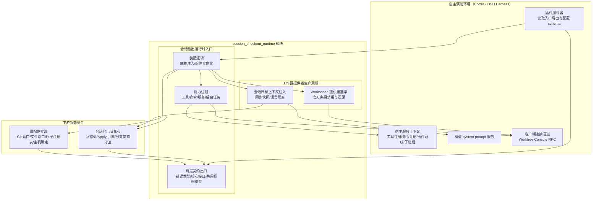

# 会话检出运行时模块（session_checkout_runtime）概述
## 模块定位与用途
`session_checkout_runtime` 是 `dsh-git-worktree` 插件的核心装配与集成层，处于 DeepSeek Harness（DSH）/Cordis 宿主演进环境与会话检出领域逻辑之间，核心目标是将与宿主无关的会话检出业务能力安全接入实际运行时环境，同时保障跨层契约稳定、依赖关系可追溯、资源生命周期可控。
模块承担的核心职责包括：
1.  作为跨层稳定契约的唯一出口，统一导出全局错误类型、核心业务接口、跨层共用视图类型，确保下层适配器与领域实现反向依赖稳定契约，避免契约漂移与循环依赖。
2.  完成全链路依赖注入与组件实例化：基于宿主配置 schema 构建 Git 执行、文件操作、跨进程原子检出注册表、会话查找、项目技能加载等端口实现，并衔接会话检出状态机、Apply 引擎等核心领域组件。
3.  向宿主注册全部对外能力面：包括模型可调用的 `worktree_*` 系列工具、用户可执行的 `/worktree` 人工验收命令、注入系统提示的动态会话运行时上下文、供客户端连接的 Worktree Console RPC 服务。
4.  管理运行时辅助集成逻辑：包括全局 Workspace UI 提供者的单例选举、会话目标上下文的动态注入、过期 Worktree 清理、已合并分支自动剪枝、并发分支竞态守卫预热等后台维护任务。
5.  保障插件卸载时的优雅资源清理：还原被临时禁用的官方 UI 条目、撤回注册的服务标记、关停所有后台定时任务，避免残留状态影响后续宿主运行。
## 模块架构
模块整体遵循「契约在上、实现在下」的依赖设计原则，架构层级与依赖关系如下图所示：

架构设计说明：
- 依赖方向上，所有下游适配器与领域组件仅依赖本模块导出的稳定契约，而非具体装配实现，从结构上避免跨层耦合。
- 工作区提供者选举逻辑在插件装配流程中最先执行，确保在 Web 渲染器初始化前完成官方 UI 条目的禁用/还原决策，避免重复提供者引发的运行时崩溃。
- 会话目标上下文注入采用同步快照机制，适配模型 system prompt 的同步求值约束，所有异步 I/O 操作（如分支竞态守卫的 reflog 探测）均放入后台定时任务执行，不阻塞 prompt 渲染流程。
## 核心组件文档索引
模块包含两个核心子组件，详细实现说明可参考以下文档：
1.  [会话检出运行时入口模块](session-checkout-runtime-entry.md)：模块的装配根与契约出口，负责定义跨层稳定类型、配置 schema、全链路装配流程、能力注册逻辑与后台任务调度规则，是理解插件初始化与挂载流程的核心参考。
2.  [工作区提供者生命周期与会话目标上下文](workspace-provider-lifecycle.md)：模块的运行时适配层，负责 Workspace UI 提供者的全局选举与生命周期管理、会话目标动态上下文的注入逻辑，是理解插件与宿主 UI、模型 prompt 集成细节的核心参考。