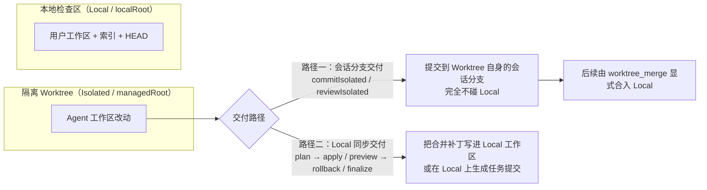
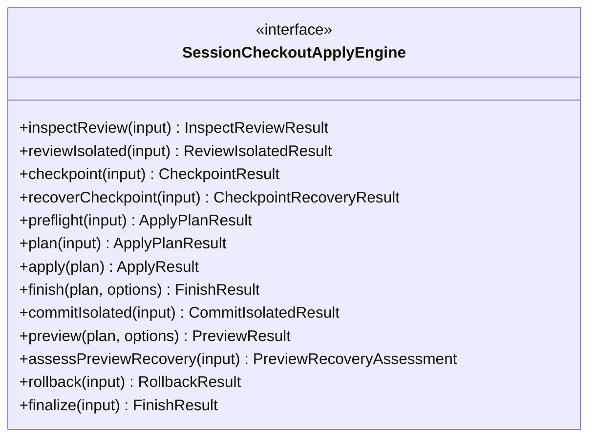
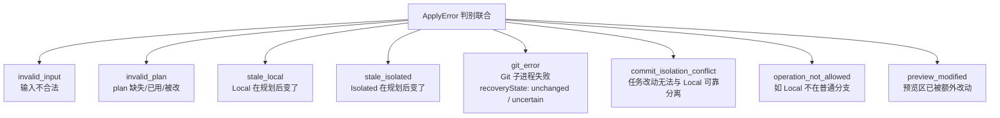
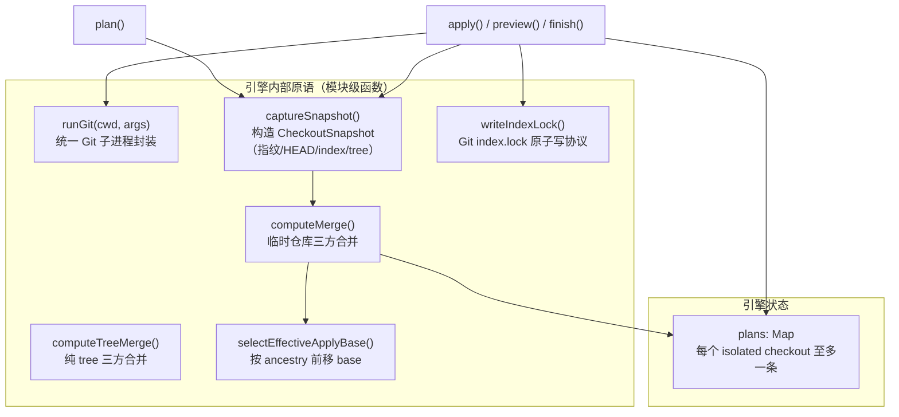
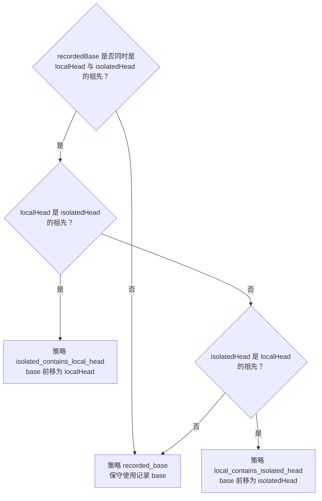
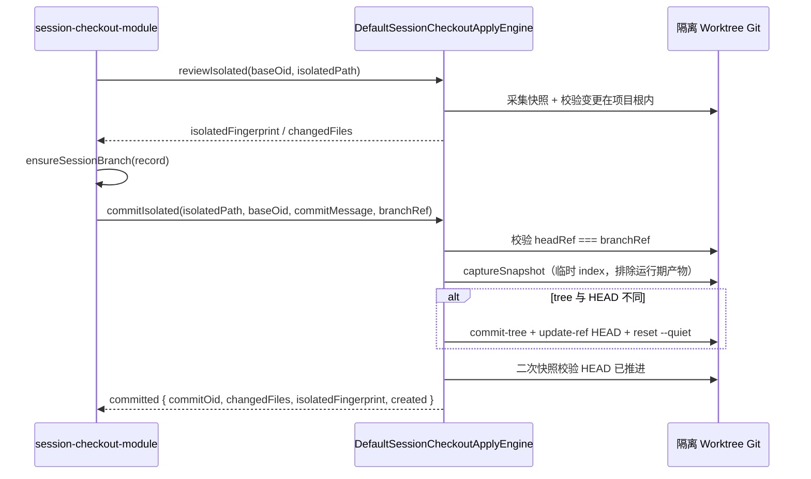
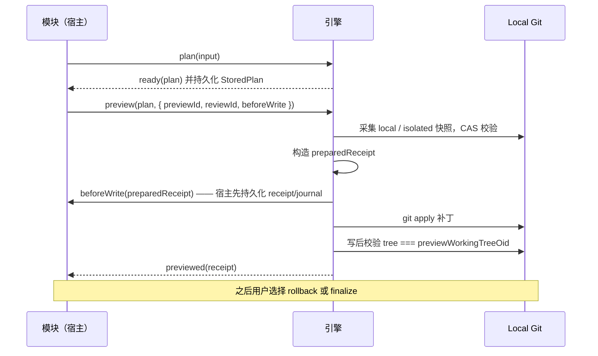
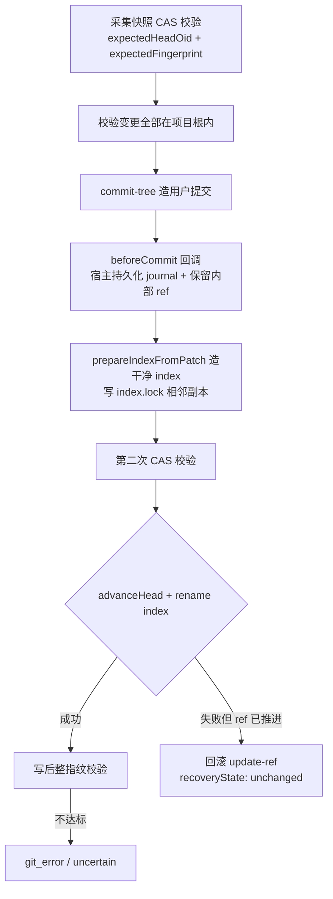
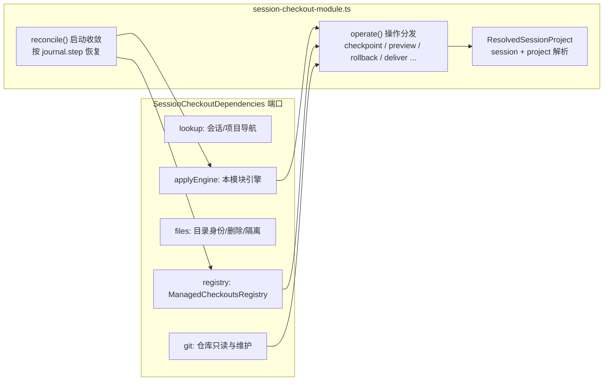
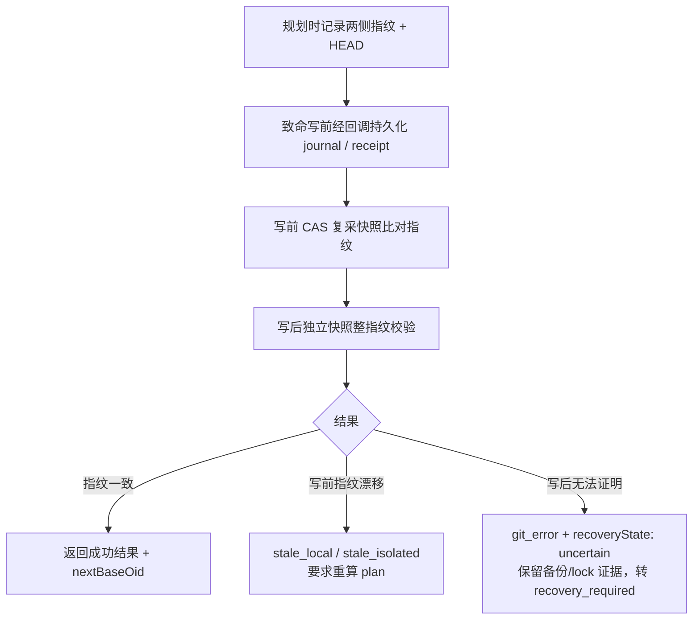

# Session Checkout：交付引擎与模块状态机

本页描述 `worktree_lifecycle_management_core` 下的 **session_checkout** 子模块，它是整个 Worktree 生命周期管理的「交付心脏」：负责把隔离 Worktree（Isolated）中的改动安全、可恢复地交付回用户的本地检查区（Local），并维护每一次交付的收据（receipt-first）、指纹 CAS 与崩溃恢复。

本模块由两个核心文件构成：

| 文件 | 角色 | 关键组件 |
| --- | --- | --- |
| `src/session-checkout-apply.ts` | 无副作用、宿主无关的 Git 交付引擎 | `SessionCheckoutApplyEngine` 接口、`DefaultSessionCheckoutApplyEngine`、`createSessionCheckoutApplyEngine` 工厂 |
| `src/session-checkout-module.ts` | 面向会话的状态机宿主编排层 | `ResolvedSessionProject` 类型、`createSessionCheckoutModule` 工厂（内部） |

> 阅读本页前建议先了解共享契约：[shared_contracts_and_domain_ports.md](../shared_contracts_and_domain_ports.md)，特别是 `SessionCheckoutDependencies`、`SessionCheckoutGitPort`、`SessionCheckoutRegistryPort`、`ManagedCheckoutRecord`、`ManagedPreviewReceipt` 等端口与记录类型。模块总览见 [worktree_lifecycle_management_core.md](../worktree_lifecycle_management_core.md)。

---

## 1. 模块定位：两条交付路径

系统存在两种「把改动送到用户身边」的语义，本模块同时支持：

- **路径一（会话分支交付，当前默认语义）**：`commitIsolated` 把 Worktree 工作区提交到它自己检出的会话分支（`refs/heads/feat/sess-…`），**完全不读写 Local**（不读其 HEAD/工作区/索引，不与之求交，不写补丁）。Local 是否合并该分支是独立、显式的一步（`worktree_merge`）。模块中 `refuseLegacyLocalWrite` 守门：会话分支存在时，旧的 Local 写入操作（apply/preview/finalize_preview）一律拒绝。
- **路径二（Local 同步交付，遗留/回滚语义）**：`plan` 在隔离 checkout 与 Local 之间计算三方合并，产出可执行 plan；`apply`/`preview` 把合并结果写进 Local；`preview` 额外产出可回滚/可定稿的 `PreviewReceipt`。

---

## 2. 核心接口：`SessionCheckoutApplyEngine`

定义于 `src/session-checkout-apply.ts`，是引擎的全部可操作面。方法按用途分组：

| 分组 | 方法 | 作用 |
| --- | --- | --- |
| 评审取证 | `inspectReview` / `reviewIsolated` | 只读快照：计算 Worktree 相对 base 的指纹、HEAD OID 与变更文件集。`inspectReview` 同时校验两侧同属一个仓库；`reviewIsolated` **完全不读 Local**，专供会话分支交付。 |
| 检查点 | `checkpoint` / `recoverCheckpoint` | 在隔离 Worktree 内保存一个私有提交（不发布到 Local）；`recoverCheckpoint` 从 `checkpoint` 崩溃中断中恢复 index/HEAD。 |
| 合并规划 | `preflight` / `plan` | 计算三方合并。`plan` 额外把 patch + 范围持久化到引擎内部的 `plans` Map（供后续一次性 apply）；`preflight` 复用同一计算但不落盘。 |
| Local 写入 | `apply` / `finish` | 按已审核 plan 把补丁写进 Local；`finish` 把任务改动从 Local 完整快照中剥离成独立任务提交，并保留用户原有 staged 状态。 |
| 会话分支 | `commitIsolated` | 把 Worktree 快照提交到它自己的会话分支，不碰 Local。 |
| 预览 | `preview` / `assessPreviewRecovery` / `rollback` / `finalize` | 可回滚的「在 Local 里预演」；产出 `PreviewReceipt`；之后可回滚或定稿为正式提交。 |

工厂函数 `createSessionCheckoutApplyEngine(options)` 返回 `DefaultSessionCheckoutApplyEngine` 实例。`SessionCheckoutApplyEngineOptions` 提供 `projectSkills`（随会话携带的 Project Skills 排除）与若干测试/宿主 seam（`beforeFinalLocalValidation`、`afterLocalWriteBeforeVerification`、`beforeFinalIsolatedValidation`、`afterIsolatedWriteBeforeVerification`）。

---

## 3. 结果类型与错误模型

所有引擎方法都返回 **可辨识联合（discriminated union）**，从不抛异常给调用方。`ApplyError` 是统一错误集：

关键结果类型速览：

- `ApplyPlanResult`：`{ status: 'ready', plan }` | `{ status: 'conflict', conflictingFiles, conflictDetails? }` | `{ status: 'error', error }`
- `ApplySuccessResult`：`{ status: 'applied', changedFiles, nextBaseOid }`，其中 `nextBaseOid` 是本次已整合的隔离快照 commit（无 ref，仅供后续 Apply 去重）。
- `PreviewReceipt`：预览的「全部事实账本」——两侧 HEAD、ref、指纹、工作区/索引 tree OID、变更文件集、`baseStrategy` 等，是 rollback/finalize 与崩溃恢复的唯一依据。
- `PreviewRecoveryAssessment`：只读地评估当前 Local 是否还能安全 rollback / finalize，返回各自的 `safe` 或 `blocked{code, conflictingFiles?}`。

---

## 4. 引擎内部架构（`DefaultSessionCheckoutApplyEngine`）

### 4.1 Git 调用卫生（`runGit`）

`runGit` 是所有 Git 子进程的唯一出口，保证仓库路由始终来自**授权 cwd**：

- **擦除环境变量**：`scrubbedAmbientGitEnv()` 移除 `GIT_DIR`、`GIT_WORK_TREE`、`GIT_INDEX_FILE` 等环境变量，防止外部环境把 Git 重定向到未授权仓库；`options.env`（如 `GIT_INDEX_FILE` 注入）始终优先。
- **禁用 hooks**：通过 `core.hooksPath` 指向一个惰性创建的空目录。
- **平台兼容**：Windows 加 `core.longpaths=true`；统一 `core.quotePath=false`、`core.fsmonitor=false`、`GIT_TERMINAL_PROMPT=0`、`LC_ALL=C`。
- **超时**：默认 30s（`GIT_TIMEOUT_MS`），超时 SIGTERM。

### 4.2 快照与指纹（`captureSnapshot` / `snapshotFingerprint`）

`CheckoutSnapshot` 是「某一侧 checkout 此刻的完整事实」：`headOid`、`headRef`、`headTreeOid`、`indexTreeOid`、`treeOid`、`indexEntries`、`fingerprint`。指纹是对 `headOid + headRef + indexEntries + treeOid` 的 SHA-256；若存在随会话携带的 Project Skills，再叠加其指纹。

> 指纹（fingerprint）是整个模块的 **CAS（compare-and-swap）基石**：每次写入前重新采集快照，比对指纹是否仍等于规划时记录的值——不等即返回 `stale_local`/`stale_isolated`，绝不盲目覆写。

采集流程还会：还原真实 index 的 staged 语义、叠加工作区、排除宿主运行期产物（`deliveryExcludePathspecs`，如 `.dsh-ops`）与随会话的 Project Skills，保证交付提交不会把这些带进目标分支。

### 4.3 有效 base 选择（`selectEffectiveApplyBase`）

三方合并的 base 不一定是配置传入的 `baseOid`：

只有当 recorded base 能证明位于两侧真实历史中时才允许 ancestry 前移；上次 Apply 的内部快照通常不在任何分支历史中，因此第二次 Apply 会保守回退到 recorded base。

### 4.4 合并计算（`computeMerge` / `computeTreeMerge`）

- `computeMerge`：在临时目录里为 Local tree 与 Isolated tree 各造一个以 base 为父的快照提交，`git init` 一个临时合并 checkout，`merge --no-commit --no-ff`；冲突时收集逐文件 combined diff（受 `CONFLICT_DETAIL_FILE_LIMIT`/`CONFLICT_DETAIL_DIFF_LIMIT` 截断，防止撑爆模型上下文）；成功时在「中央 index」里重放补丁得到合并后 tree。
- `computeTreeMerge`：纯 tree 级三方合并（不依赖真实 checkout），被 rollback/finalize/finish 用于推导「剥离任务改动后的目标 tree」。

---

## 5. 交付流程时序

### 5.1 会话分支交付（`commitIsolated`，默认路径）

要点：提交树取自与「评审快照」同一条临时 index 构造路径，已排除宿主运行期产物与 Project Skills；`empty ident` 类 Git 配置错误会被翻译成可执行的「请先配置提交身份」提示。

### 5.2 可回滚预览（`preview` → `rollback` / `finalize`）

- **收据优先（receipt-first）**：`beforeWrite` 回调在触碰 Local **之前**先持久化 `PreviewReceipt` 与变更 journal。这样即使进程在写补丁后崩溃，重启时 `assessPreviewRecovery` / `reconcile` 仍能凭收据判断能否安全回滚。
- **rollback**：先经 `prepareRollbackAssessment` 评估（Local 分支是否漂移、预览区是否被额外改动），再用 tree patch 写回「预览前 tree」，最后整指纹 CAS 校验。
- **finalize**：把预览中的任务改动分离成正式提交；用 Git 标准 `index.lock` 协议保护「校验 → update-ref → 换 index」临界区；失败时按 `refUpdated / indexReplaced` 矩阵补偿回滚，无法证明则返回 `recoveryState: 'uncertain'` 并保留 index 备份。

### 5.3 检查点（`checkpoint` / `recoverCheckpoint`）

`checkpoint` 的设计是「**先把可恢复证据落盘，再做致命写**」：`beforeCommit` 在 HEAD/index 被改动之前就把 `commitOid/parentOid/indexTreeOid` 写进 journal 并保留内部 ref。`recoverCheckpoint` 据此判定中断发生在哪一步：HEAD 还在 parent → 中止；HEAD 已到 commit 但 index 未换 → 补换干净 index 并校验。

---

## 6. 与模块编排层（`session-checkout-module.ts`）的关系

`createSessionCheckoutModule(dependencies)` 不重新实现 Git 逻辑，而是把引擎作为 `dependencies.applyEngine` 注入进来，围绕它做**会话级状态机编排**：

- **`ResolvedSessionProject`**：`{ session: SessionCheckoutSessionRecord, project: SessionCheckoutProjectRecord }`，由 `resolveSessionProject()` 经 `lookup.getSession → getProject → files.exists(project.root)` 解析；任一步缺失即抛 `SessionCheckoutError`（`session_not_found` / `project_not_found` / `project_root_missing`）。
- **journal 与引擎回调的咬合**：模块在调用引擎的 `beforeCommit` / `beforeWrite` 回调里推进 `ManagedCheckoutMutationJournal` 的 `step`（`planning → artifacts_retained → committing_session_branch → writing_local → updating_ref → replacing_index`）。引擎保证「致命 Git 写发生在回调 resolve 之后」，模块则保证「journal 永远先于写落盘」——两者共同构成崩溃一致性。
- **reconcile 恢复策略**：启动时遍历 `phase === 'mutating'` 的记录，按 `journal.operation + step` 精确恢复，例如 `checkpoint` 停在 `updating_ref` 就调用 `recoverCheckpoint`；停在 `planning` 判定 Local 未被触碰则直接回到 `ready`。
- **sibling → fallback 的受控容器降级（`bindTarget`）**：首次创建（`createAttempt === 0`）且 sibling 容器不会污染外层仓库时，优先使用 sibling 容器；若容器身份校验失败（`containerIdentity === null`），仅当 **sibling 容器与 fallback 容器不是同一个目录**（`fallbackContainerDiffers`，经 `pathsEqual` 比对 `pathCandidates[0].siblingContainer` 与 `fallbackContainer`）时才允许 `createAttempt + 1` 重试一次。配置了 `worktreesRoot` 时 sibling 与 fallback 指向同一容器，重试只会面对同一个目录与同一份内容、注定再失败一次，因此不再重试，而是直接抛出 `checkout_mismatch`，消息经 `hostMessage('theFallbackWorktreeContainerIsNotATrustedDirectory', { p0: managedContainer })` 携带具体容器路径，引导人工处理。

---

## 7. 一致性与恢复保证总览

三个层级的保证：

1. **规划-执行原子性**：`plans` Map 每个 isolated checkout 只存一条；`apply/preview/finish` 必须提供与存储完全匹配的 `ApplyPlan`（`planMatches` 逐项比对），否则 `invalid_plan`。
2. **写前 CAS**：任何 Local/Isolated 写入前重新采集快照，指纹不等即拒绝（`stale_*`）。
3. **崩溃可恢复**：journal + receipt + 内部 ref 三重证据；`reconcile` 与 `recoverCheckpoint` 把中断收敛回 `ready`、`recovery_required` 或已校验的完成态。

---

## 8. 与其他模块的关系

- **共享契约与端口**：`SessionCheckoutDependencies`、`SessionCheckoutGitPort`、`ManagedCheckoutRecord`、`ManagedPreviewReceipt`、`ManagedCheckoutMutationJournal` 等均定义于 [shared_contracts_and_domain_ports.md](../shared_contracts_and_domain_ports.md)；引擎只依赖 `SessionCheckoutApplyEngine` 自身与 `ProjectSkillStore`（见 [adapters 子页](../shared_contracts_and_domain_ports/adapters.md) 的 project-skills）。
- **创建失败**：Worktree 创建期失败的回滚与 `recovery_required` 标记见 [creation_failure.md](creation_failure.md)。
- **路径候选与会话分支命名**：`createSessionBranchCandidates`、`createManagedWorktreePathCandidates` 见 [managed_worktree_path.md](managed_worktree_path.md)。
- **模块入口与完整操作面**：`SessionCheckoutModule` 接口、`SessionCheckoutError`、`createSessionCheckoutModule` 的挂载见 [worktree_lifecycle_management_core_index.md](worktree_lifecycle_management_core_index.md)。
- **上层控制台**：交付状态被投影成 `WorktreeConsoleAdapter` 的请求/响应，见 [../console_control_plane_and_services/console_host.md](../console_control_plane_and_services/console_host.md)；预览恢复的客户端续接见 [../client.md](../client.md) 的 recovery-continuation。
