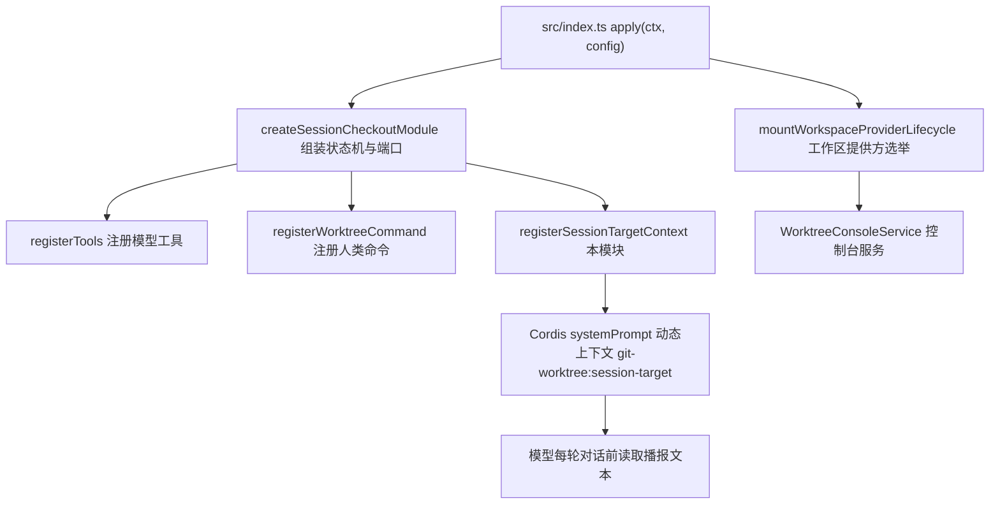
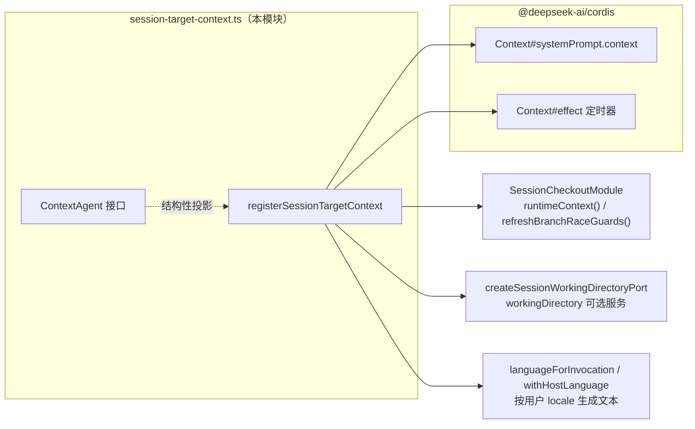
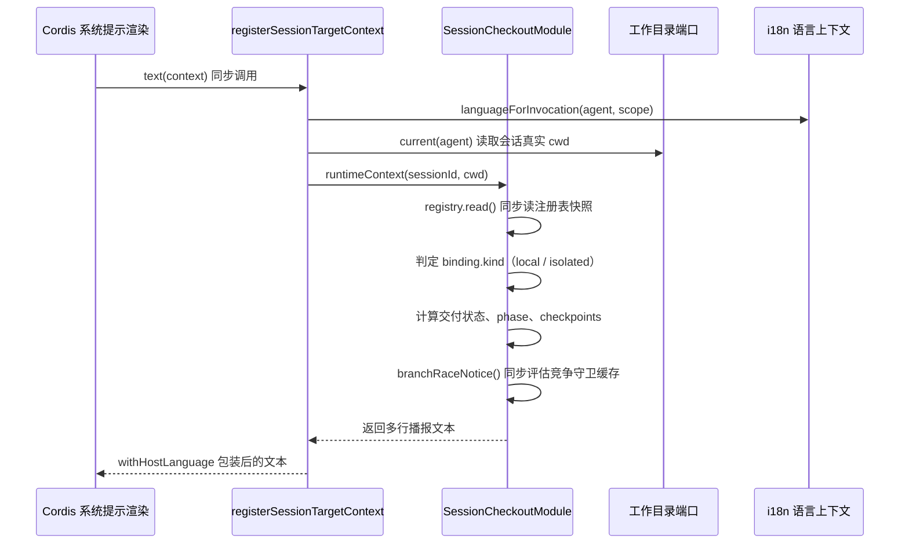
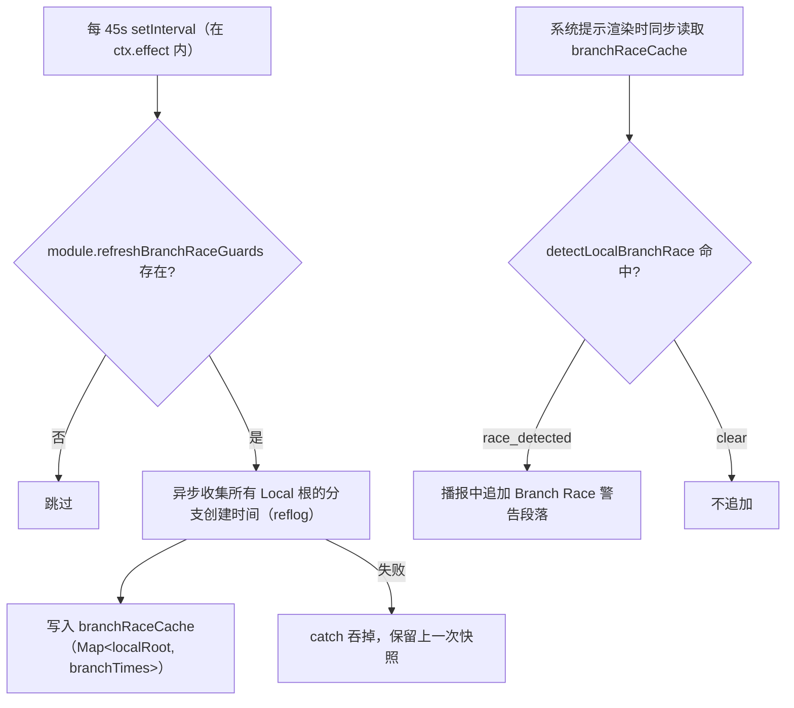
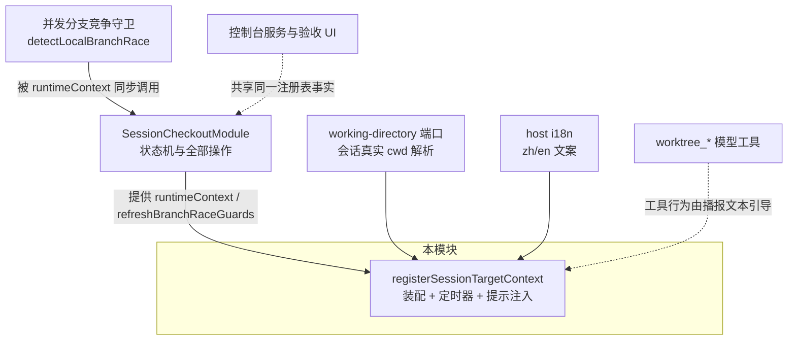

# Session Target 运行时上下文（session_target_context）

## 简介

`session_target_context` 模块（核心文件 `src/session-target-context.ts`）是 dsh-git-worktree 插件面向**模型（Agent）系统提示**的"环境播报"装配点。它把 session-checkout 状态机推导出的当前会话目标状态（Session Target），以**同步、可回放（replay-stable）**的文本形式注入 Cordis 的动态系统提示上下文 `git-worktree:session-target`，让模型在每一轮对话开始前就能知道：

- 当前会话工作在 Local Checkout 还是某个 Isolated Checkout（托管 Worktree）中；
- 交付状态（working / ready_for_review / preview_active / preview_detached / delivered / retained 等），从而决定该调用哪个 `worktree_*` 工具、哪些动作被禁止；
- 当前会话是否真实位于 Worktree 的权威 cwd 之内（若不是，则必须用绝对路径写文件）；
- 是否处于并发分支竞争（branch race）中——此时模型必须先 `worktree_create` 隔离，绝不能再在 Local 上直接建分支。

整个模块**不做任何 Git 或文件系统 I/O**：文本全部由 `SessionCheckoutModule.runtimeContext(sessionId, cwd)` 基于注册表快照同步生成，唯一的异步副作用是每 45 秒在后台刷新一次分支竞争守卫缓存（reflog 探测），以满足系统提示"文本提供函数必须同步"的契约。

---

## 核心组件一览

| 组件 | 位置 | 职责 |
| --- | --- | --- |
| `ContextAgent` | `src/session-target-context.ts` | 对 Host Agent 对象的最小结构性投影：仅读取 `agent.session.id` 以确定当前会话。 |
| `registerSessionTargetContext(ctx, module)` | `src/session-target-context.ts` | 模块主入口：装配工作目录端口、启动后台分支竞争刷新定时器、并向 `systemPrompt` 注入动态上下文。 |
| `SessionCheckoutModule.runtimeContext(sessionId, cwd)` | `src/session-checkout-module.ts` | 同步生成播报文本的真正实现（由 [session_checkout](session_checkout.md) 提供）。 |
| `SessionCheckoutModule.refreshBranchRaceGuards()` | `src/session-checkout-module.ts` | 异步刷新分支创建时间缓存的可选方法，由本模块定时器驱动。 |
| `createSessionWorkingDirectoryPort(ctx)` | `src/adapters/working-directory.ts` | 从 Host 可选服务 `workingDirectory` 解析当前会话真实 cwd 的适配端口。 |
| `languageForInvocation(agent, ctx)` / `withHostLanguage(...)` | `src/i18n/host.ts` | 按调用时 Agent 所属的用户设置语言（locale）生成播报文本。 |

---

## 架构定位

### 在插件装配流水线中的位置

`registerSessionTargetContext` 在插件 `apply`（`src/index.ts`）中被调用，与工具注册、人类命令注册并列，属于"插件面"最后一批挂载的上下文装配：

### 依赖关系

模块本身只持有装配逻辑，所有状态语义都委托给 `SessionCheckoutModule`（见 [session_checkout](session_checkout.md)），并发竞争的纯谓词见 [concurrency](concurrency.md)，工作目录适配端口详见 [shared_contracts_and_domain_ports/adapters](../shared_contracts_and_domain_ports/adapters.md)。

---

## 运行时行为

### 装配过程

`registerSessionTargetContext` 做三件事：

1. **创建工作目录端口**：`createSessionWorkingDirectoryPort(ctx)` 动态解析 Host 的 `workingDirectory` 服务；未挂载时返回 `undefined`，播报自动降级为"guidance-only"模式（提示模型用绝对路径写文件）。
2. **启动后台分支竞争刷新**：在 `ctx.effect` 中注册一个每 45 秒触发的 `setInterval`，调用 `module.refreshBranchRaceGuards()` 并吞掉所有失败（失败时保留上一次快照）。effect 卸载时清理定时器，保证跨代际重启不泄漏。
3. **注入系统提示上下文**：通过 `ctx.inject(['systemPrompt'], ...)` 注册名为 `git-worktree:session-target`、`order: 118` 的动态上下文，其 `text` 是同步函数：
   - 从 `context.agent`（经 `ContextAgent` 投影）读取 `session.id`；
   - 用 `languageForInvocation(context.agent, scope)` 取该用户的 locale，再包进 `withHostLanguage(...)` 的异步上下文；
   - 若 `sessionId` 为字符串，调用 `module.runtimeContext(sessionId, workingDirectory.current(context.agent))`；
   - 否则返回空串（非会话上下文不播报）。

### 一次播报的生成流程

### 后台分支竞争刷新流程

---

## 播报文本的典型分支

`runtimeContext(sessionId, cwd)` 根据注册表中该会话的绑定与托管记录，输出完全不同的指引段落（以下为英文原文示意，实际按用户 locale 输出 zh/en）：

| 场景 | 关键判定 | 播报要点 |
| --- | --- | --- |
| 无绑定的新会话 | `sessionBindings[sessionId]` 不存在 | 仅输出 `branchRaceNotice` 结果；竞争时警告"勿在 Local 建分支，先 worktree_create"。 |
| Local 绑定且无待办托管记录 | `binding.target.kind === 'local'` 且无 pending checkout | "Session Target: Local Checkout. No isolated target is active"——禁止调用仅 Worktree 工具。 |
| Local 绑定但有他人预留的托管 checkout | pending 记录 `ownerSessionId !== sessionId` | "handoff pending"——停止改代码，请用户打开隔离会话。 |
| Local 绑定但拥有本会话的 checkout | pending 记录 `ownerSessionId === sessionId` | 提示已拥有隔离 checkout，必须用绝对路径写文件，勿重复 `worktree_create`。 |
| 本地预览激活/脱离 | `delivery.state` 为 `preview_active` / `preview_detached` | 模型必须只读，等待用户通过验收 UI 接受/回滚/丢弃。 |
| 隔离绑定正常工作 | `binding.target.kind === 'isolated'` 且记录有效 | 列出 `managedRoot` 权威 cwd 与 `localRoot` 边界；若 cwd 不在 Worktree 内，追加"所有写入必须用绝对路径"的强制规则。 |
| 已交付且已清理 | `phase === 'discarded'` 且 `delivery.state === 'delivered'` | 告知 Worktree 已交付清理，回到 Local 边界；新需求须先 `worktree_begin_next_iteration`，勿再 `worktree_create`。 |
| 已交付但保留/等待清理 | `finalized` / `retained` 且 cwd 不在 Worktree 内 | 说明提交已在会话分支上，Local 未被写入；指引先 `worktree_merge` 再 `worktree_cleanup`。 |
| 需要恢复 | `phase === 'recovery_required'` 或身份校验失败 | 禁止修改 Local、禁止自动清理，等待恢复流程。 |

---

## 关键设计约束

### 1. 同步与 replay-stable

系统提示契约要求 `text(context)` 必须**同步返回字符串**。因此：

- 播报文本**绝不 spawn Git 子进程、绝不做文件 stat**；全部基于 `registry.read()` 的 JSON 快照与内存中的 `branchRaceCache`。
- 分支创建时间这类"需要 Git I/O"的数据，被剥离到独立的异步刷新（45 秒一次），同步播报只是读取缓存；探测失败时守卫保持静默（保守策略），绝不阻塞模型工作。
- `workingDirectory.current(agent)` 本身是同步的 Host 服务读取（未挂载即 `undefined`）。

### 2. 不执行任何副作用

模块文件头注释明确：**"Register a per-assembly snapshot without performing Git or filesystem I/O."** 所有 Git/文件副作用都发生在 [session_checkout](session_checkout.md) 的状态机内（如 `inspect`、`bind`、`createIsolatedTarget`），本模块只是"读状态、写提示"。

### 3. 语言按调用隔离

播报文本通过 `AsyncLocalStorage` 绑定到当前调用的语言：`languageForInvocation` 优先读 `agent.ctx`（每个 Agent 独立的 scoped settings），避免多用户/多会话之间串语言。

### 4. cwd 判定采用"包含而非相等"

会话经常 `cd` 进子目录——只要 `cwd` 落在 `managedRoot` 之内（跨平台大小写与分隔符归一），就认为"已在 Worktree 内"，不重复输出绝对路径强制规则。该包含判定与工作目录端口（`working-directory.ts`）的 `isWithin` 保持一致，避免"播报说在里面、端口说不在里面"的自相矛盾。

### 5. 定时器生命周期与跨代际安全

- `setInterval` 注册在 `ctx.effect` 中，插件卸载/重启时自动 `clearInterval`；
- `refreshBranchRaceGuards` 的失败被显式 `catch`，不污染宿主日志；
- 若 `module.refreshBranchRaceGuards` 不存在（某些测试宿主未提供），整个定时器分支被跳过。

---

## 与其它模块的关系

- 状态机与交付语义的完整说明：[session_checkout](session_checkout.md)。
- 并发分支竞争的纯谓词与数据结构：[concurrency](concurrency.md)。
- 工作目录适配端口与 Host 服务契约：[shared_contracts_and_domain_ports/adapters](../shared_contracts_and_domain_ports/adapters.md)。
- 插件整体装配、配置（`branchRaceGuard` / `branchRaceWindowMs` / `autoDeliver` 等 volatile 字段如何影响播报）与启动维护定时器：[worktree_lifecycle_management_core_index](worktree_lifecycle_management_core_index.md)。
- 工作区提供方选举（`mountWorkspaceProviderLifecycle`）在装配顺序上先于本模块，但二者无运行时依赖：[workspace_provider_lifecycle](workspace_provider_lifecycle.md)。
- 控制台如何复用同一注册表向 Sidebar/评审面板投影状态：[../console_control_plane_and_services/console_host](../console_control_plane_and_services/console_host.md)。

---

## 配置影响

播报文本内容直接受以下 volatile 配置（定义于 `src/index.ts` 的 `Config` schema）影响，这些值在每次 `runtimeContext` 调用时通过 `liveConfigValue` 实时读取，无需重装插件：

| 配置 | 默认 | 对播报的影响 |
| --- | --- | --- |
| `branchRaceGuard` | `true` | 关闭时 `branchRaceNotice` 立即返回空串，竞争段落不再出现。 |
| `branchRaceWindowMs` | `30min` | 竞争检测窗口；窗口内新建的分支才会触发警告。 |
| `autoDeliver` | `true` | Working 状态播报指向 `worktree_deliver`（自主交付）；关闭时改为指向 `worktree_ready_for_review` 等待人工验收。 |

这些字段在设置页修改后会写入 `cordis.patch.yml`（见 [build_and_configuration](../build_and_configuration.md)），以 live reference 形式注入，下一次系统提示渲染即生效。
