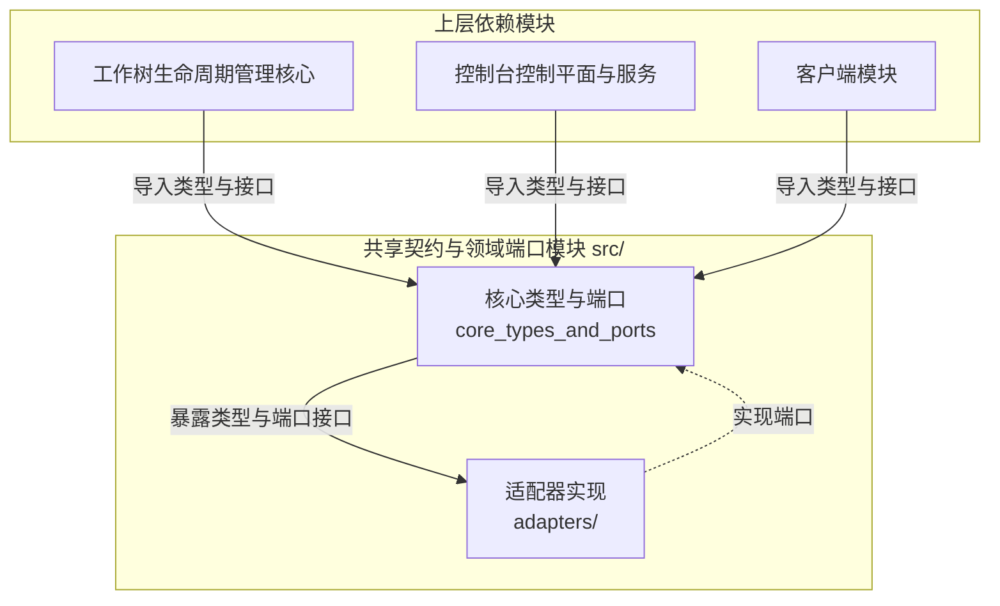
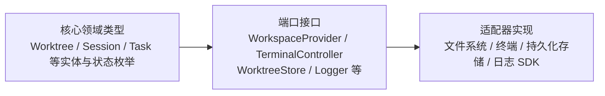
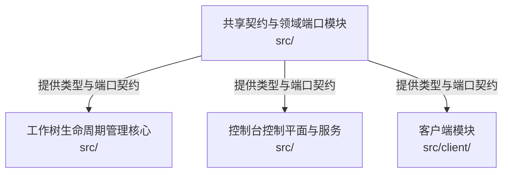

# 共享契约与领域端口模块

## 模块定位与目标

`shared_contracts_and_domain_ports` 位于项目 `src/` 目录下，是整个工作树生命周期管理系统的**共享基础层**。该模块的核心目标是：

1. **统一领域契约**：集中定义工作树、会话、任务等核心业务实体的类型与状态枚举，确保所有上层模块对同一业务概念的理解一致。
2. **定义端口抽象**：通过接口抽象出工作区管理、终端控制、持久化存储等外部依赖，使核心业务逻辑与具体实现解耦。
3. **提供适配器实现**：为端口接口提供默认的具体实现，便于模块快速接入真实运行环境。

该模块是典型的**六边形架构（端口与适配器）**中的契约层，向下隔离外部基础设施，向上为 `worktree_lifecycle_management_core`、`console_control_plane_and_services`、`client` 等模块提供统一的类型与接口依赖。

## 架构组成与依赖关系

本模块由两个核心子模块组成：

| 子模块 | 职责 | 详细文档 |
| --- | --- | --- |
| `core_types_and_ports` | 定义核心领域类型、状态枚举以及端口接口，是整个共享契约层的核心。 | [core_types_and_ports.md](shared_contracts_and_domain_ports/core_types_and_ports.md) |
| `adapters` | 实现端口接口的具体适配器，将抽象端口与真实外部系统（文件系统、终端、数据库）连接。 | [adapters.md](shared_contracts_and_domain_ports/adapters.md) |

### 模块内部结构

### 核心抽象层次

## 与其他模块的协作关系

`shared_contracts_and_domain_ports` 作为基础层，被多个上层模块依赖：

## 关键组件

- **核心类型与端口**：定义了系统中最基础的业务实体抽象与外部依赖端口，详见 [core_types_and_ports.md](shared_contracts_and_domain_ports/core_types_and_ports.md)。
- **适配器**：提供了端口接口的默认实现，负责连接真实的基础设施，详见 [adapters.md](shared_contracts_and_domain_ports/adapters.md)。