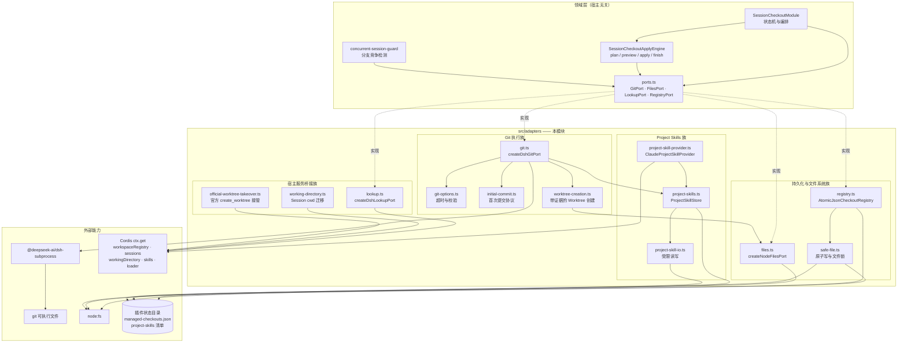
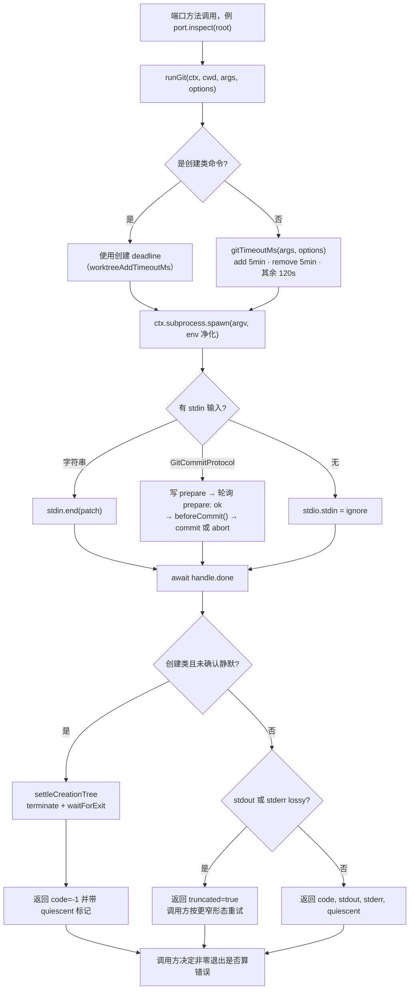
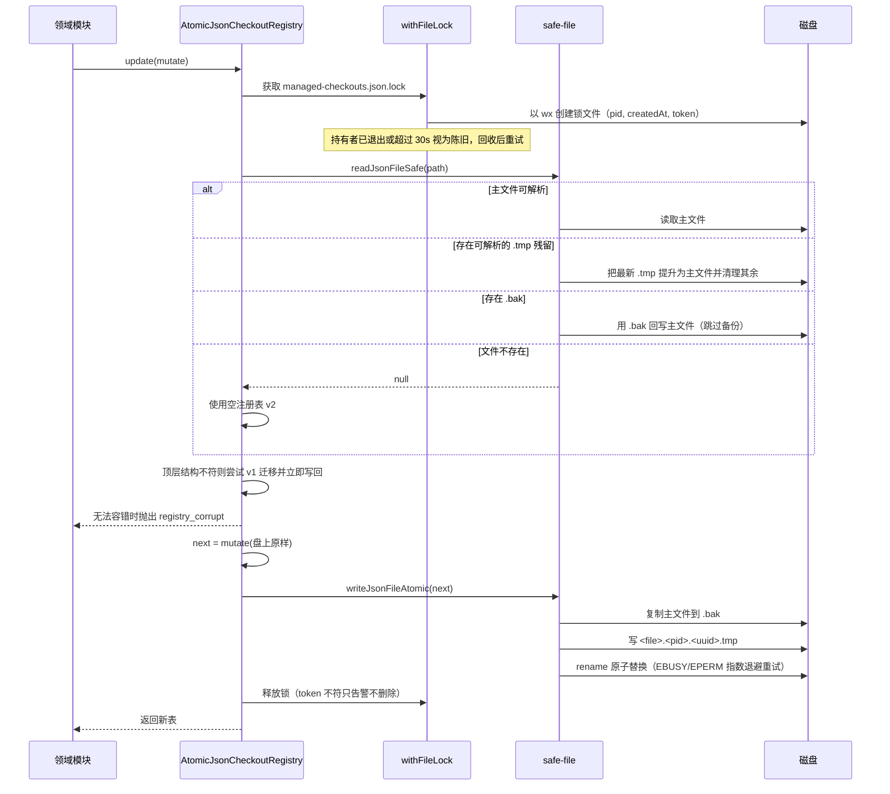
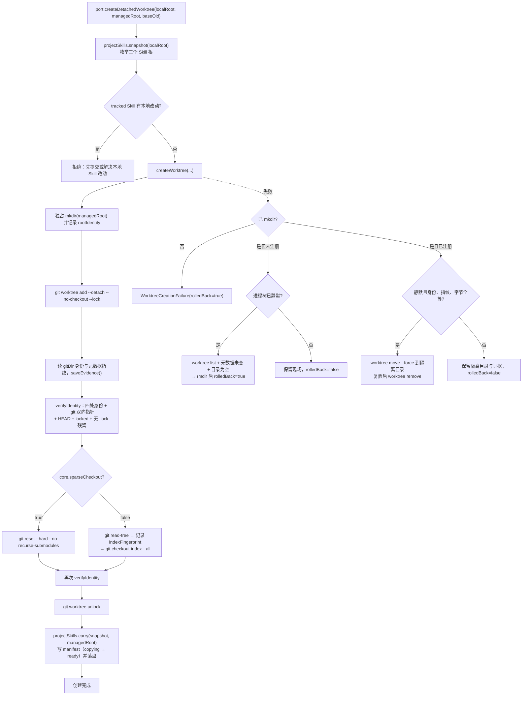

# src_adapters：会话检出（Session Checkout）的宿主适配层

## 1. 模块定位

`src/adapters/` 是 **dsh-git-worktree** 插件的「基础设施边界」。核心状态机（`SessionCheckoutModule`）、Apply 引擎与领域契约（`ports.ts` / `types.ts`）是宿主无关的纯逻辑：它们只声明 **端口（Port）接口**，从不直接调用 `node:fs`、`git` 或 Harness 服务。本模块把这些端口逐一实现为可在真实 DeepSeek Harness（DSH）宿主上运行的 **适配器（Adapter）**：

| 领域端口（定义见 [session_checkout_domain_contracts](session-checkout-domain-contracts.md)） | 本模块提供的实现 | 依赖的外部能力 |
| --- | --- | --- |
| `SessionCheckoutGitPort` | `createDshGitPort`（`src/adapters/git.ts`） | `@deepseek-ai/dsh-subprocess`、`git` 可执行文件 |
| `SessionCheckoutFilesPort` | `createNodeFilesPort`（`src/adapters/files.ts`） | `node:fs` / `node:fs/promises` |
| `SessionCheckoutLookupPort` | `createDshLookupPort`（`src/adapters/lookup.ts`） | Cordis `workspaceRegistry` / `sessions` / `sessionQuery` / `workingDirectory` 服务；新增可选 `listProjects()` 把 Local 根反向归属宿主 Workspace 项目 |
| `SessionCheckoutRegistryPort` | `AtomicJsonCheckoutRegistry`（`src/adapters/registry.ts`） | 插件状态目录下的 `managed-checkouts.json` |
| —（工具层） | `createSessionWorkingDirectoryPort`（`src/adapters/working-directory.ts`） | Cordis `workingDirectory` 服务 |
| —（Skill 生态） | `ProjectSkillStore` / `ClaudeProjectSkillProvider`（`src/adapters/project-skill*.ts`） | `@deepseek-ai/dsh-skill`、`@deepseek-ai/dsh-skill-filesystem` |

一句话概括：**上游领域层决定「该做什么」，本模块决定「怎样在 Windows/Linux 的一台真实机器上安全地做」**。因此本模块的大部分代码不是业务逻辑，而是 **安全强化（hardening）**：目录身份（device/inode/birthtime）校验、原子写与崩溃恢复、跨进程文件锁、argv 直传不经 shell、环境变量净化、隔离区（quarantine）与拒绝删除策略。

## 2. 装配入口

所有适配器在插件挂载函数 `apply()`（`src/index.ts`）里一次性构造并注入领域模块，见 `src/index.ts:370-408`：

```text
stateDir   = $DSH_HOME | ~/.dsh / plugins / dsh-git-worktree
hooksPath  = <stateDir>/disabled-git-hooks        ← 空目录，用于关闭 git hooks
projectSkills = new ProjectSkillStore(<stateDir>/project-skills)
lookup     = createDshLookupPort(ctx)
git        = createDshGitPort(ctx, { hooksPath, projectSkills, gitTimeoutMs, worktreeAddTimeoutMs })
files      = createNodeFilesPort()
registry   = new AtomicJsonCheckoutRegistry(<stateDir>/managed-checkouts.json)
mountProjectSkillProvider(ctx, registry)
module     = createSessionCheckoutModule({ lookup, git, files, registry, applyEngine, managedCheckoutsRoot, ... })
```

`registry`、`git`、`files`、`lookup` 这四个端口实例随后还被复用给 Console 宿主服务的控制平面（`WorktreeConsoleService` / `createWorktreeConsoleControlPlane`），详见 [worktree_console_host](worktree-console-host.md)。

## 3. 架构总览



## 4. 子模块划分

本模块按「安全契约的边界」而不是按文件数量划分为四个子模块。下表是生成的子模块页面索引，四个页面共同覆盖 `src/adapters/` 与 `src/official-worktree-takeover.ts` 的全部 13 个文件：

| 子模块页面 | 覆盖文件 | 一句话职责 |
| --- | --- | --- |
| [src_adapters_git_execution](src-adapters-git-execution.md) | `git.ts`、`git-options.ts`、`initial-commit.ts`、`worktree-creation.ts` | Git 命令的唯一出口、超时策略、首次提交协议与可证明的 Worktree 创建/回滚 |
| [src_adapters_persistence](src-adapters-persistence.md) | `registry.ts`、`safe-file.ts`、`files.ts` | 崩溃安全的注册表落盘、跨进程文件锁、目录身份与安全删除 |
| [src_adapters_project_skills](src-adapters-project-skills.md) | `project-skills.ts`、`project-skill-io.ts`、`project-skill-provider.ts` | 随会话携带的私有 Skill 资源：复制、遮蔽与发现 |
| [src_adapters_host_binding](src-adapters-host-binding.md) | `lookup.ts`、`working-directory.ts`、`official-worktree-takeover.ts` | 把 Cordis 动态服务翻译成端口，并在服务缺失时降级而非报错；同时通过 Loader 接管官方 `create_worktree` 工具 |

### 4.1 Git 执行族 → [src_adapters_git_execution](src-adapters-git-execution.md)

包含 `git.ts`、`git-options.ts`、`initial-commit.ts`、`worktree-creation.ts`。这是本模块风险最高的一片：所有对仓库的读写都汇聚到 `runGit()` 这一个函数上。核心不变量：

- **argv 直传**，绝不经过 shell 解释；固定注入 `--no-pager`、`--no-optional-locks`、`core.quotePath=false`、`core.fsmonitor=false` 与空的 `core.hooksPath`（禁用 hooks），Windows 上追加 `core.longpaths=true`。
- **环境净化**：从 `process.env` 中剥离 `GIT_DIR`、`GIT_WORK_TREE`、`GIT_INDEX_FILE`、`GIT_OBJECT_DIRECTORY` 等仓库路由变量，仓库位置只由已授权的 `cwd` 决定；同时强制 `GIT_TERMINAL_PROMPT=0`、`GIT_OPTIONAL_LOCKS=0`、`LC_ALL=C`、`LANG=C`，保留身份与常规用户配置。
- **输出有界**：每条命令有 stdout/stderr 采集上限（常规 1 MiB，`status` 与 WIP 补丁 16 MiB）；溢出时返回 `truncated` 而非直接判死，`status` 会退化到 `--untracked-files=normal` 重读。
- **内部 ref 命名空间**：插件产物一律写入 `refs/dsh-worktree/session-checkouts/<sha256 前 24 位>/<artifact>`，放弃快照写入 `refs/dsh-worktree/abandoned/<checkoutId>`，与用户分支彻底隔离。
- **创建即留证据**：`worktree-creation.ts` 采用「独占 `mkdir` → `worktree add --no-checkout --lock` → 身份与元数据指纹校验 → `read-tree`/`checkout-index` → `unlock`」的可回滚序列；任何失败都要么证明目录为空、要么通过字节级 `verifyUnmodified` 证明未被改动，才允许回收，否则一律隔离并保留现场。

### 4.2 Project Skills 族 → [src_adapters_project_skills](src-adapters-project-skills.md)

包含 `project-skills.ts`、`project-skill-io.ts`、`project-skill-provider.ts`。负责把本地检出中 `.dsh/skills`、`.agents/skills`、`.claude/skills` 三个根目录下的 **宿主私有资源**随会话带入托管 Worktree，并在 `git status` 判定「是否存在可交付改动」时把这些辅助文件排除（`hasDeliverableStatus` 只把 `??` 记录视为辅助，tracked 的修改/重命名/删除始终可见）。关键设计：溯源清单（manifest）保存在宿主私有的插件状态目录，**永不接受来自被管检出内部的排除清单**；读写全程使用 `O_NOFOLLOW` 与逐段 `lstat`，拒绝符号链接与特殊文件；`phase === 'copying'` 的清单被视为不完整而直接失败。`ClaudeProjectSkillProvider` 还通过宿主 skills 服务把 `.claude/skills` 注册为额外的项目级 Skill 源，其根目录只能由注册表中 `phase === 'ready'` 的记录反查、并验证 `.git` 双向指针后得出。

### 4.3 持久化与文件系统族 → [src_adapters_persistence](src-adapters-persistence.md)

包含 `registry.ts`、`safe-file.ts`、`files.ts`。注册表是插件唯一的持久真相源（`version: 2`，含 `sessionBindings` 与 `managedCheckouts`）。这里解决三类事故：

1. **截断**：写入采用「唯一命名 `.tmp` → `rename` 原子替换 → `.bak` 备份」，读取按「主文件 → 最新可解析的 `.tmp` 残留 → `.bak`」逐级回退。
2. **并发覆盖**：`withFileLock()` 提供跨进程互斥（锁文件记录 `pid`/`createdAt`/`token`，30 秒判陈旧、10 秒获取超时、进程内可重入）；`AtomicJsonCheckoutRegistry.update()` 把「读-改-写」整体放进同一把锁。
3. **局部损坏**：`sanitizeRegistry()` 逐条校验并丢弃坏记录（只作用于内存视图，**不回写磁盘**），避免一条损坏记录让全部 Worktree 失去访问；v1 旧表保守迁移，除 `ready`/`discarded` 外一律降级为 `recovery_required`。

`files.ts` 额外提供目录身份（`device` / `inode` / `birthtimeNs`）、只删空目录树且遇到链接只 `unlink` 不跟随、以及要求同父目录且身份一致的隔离区搬迁。

### 4.4 宿主服务桥接族 → [src_adapters_host_binding](src-adapters-host-binding.md)

包含 `lookup.ts`、`working-directory.ts`、`official-worktree-takeover.ts`。前二者的共同点是 **对宿主服务做结构性探测并优雅降级**：服务未挂载、形状不符或抛异常时返回 `undefined` / 空列表，让状态机把它读成「孤儿或恢复事实」而不是失败。`lookup.ts` 还包含一条重要的补偿逻辑——当 Harness 因不可变 cwd 已消失而把 Session 从 `Workspace.sessionIds` 过滤掉时，可用该 Session **仍存活**的 header cwd 精确恢复映射；其 `getSessionCwd` 则以宿主 `workingDirectory` 服务的实时 `get(session)` 投影为第一授权证据、冻结的 header cwd 为兜底（会话被 `workingDirectory.set` 搬进 Worktree 后 header 已失真）；`listProjects()` 把 Local 根反向归属宿主 Workspace 项目（官方工具创建的 Worktree 可能既无台账绑定也无会话投影覆盖）；`working-directory.ts` 则是把 Session 真正「放进」新检出的机制（官方实验性 worktree bundle 的最后一步即 `workingDirectory.set(agent, path)`）；`official-worktree-takeover.ts` 则是与 Workspace provider 选举平行的 Loader 接管——禁用官方 `create_worktree` 工具 bundle 条目并注册按工具名拦截的 `ctx.tools.guard`，卸载时只还原本插件亲手禁用的条目，绝不触碰用户 override。

## 5. 关键数据流

### 5.1 一次 git 命令的生命周期



`runGitChecked()` 是把非零退出转成 `SessionCheckoutError('git_operation_failed', ...)` 的便捷包装；而 `isAncestor`、`resolveLocalBranchTip`、`pushBranch`、`branchOverview` 等刻意保留退出码语义（0/1 分别代表真/假或存在/不存在），不抛异常。

### 5.2 注册表读写与崩溃恢复



`read()` 走同一条加载路径，但**只在内存视图上做 `sanitizeRegistry()` 分区降级**；任何写回都以磁盘事实为基础，从而保证被丢弃的坏记录不会被一次无关写入悄悄抹掉。

### 5.3 创建托管 Worktree（含 Project Skills 携带）



## 6. 与系统其他部分的关系

- **上游契约**：所有端口方法签名与 `ManagedCheckoutRecord` 各字段（`phase`、`delivery`、`journal`、`checkpoints`、`recoveryContinuation` 等）的语义由 [session_checkout_domain_contracts](session-checkout-domain-contracts.md) 定义；本模块只实现，不重新定义。
- **调用方**：状态机与编排见 [session_checkout_runtime](session-checkout-runtime.md)；Apply/Preview/Checkpoint/Finish 的具体事务在 [session_checkout_apply_engine](session-checkout-apply-engine.md)。注意二者是**两条独立的 git 通道**：Apply 引擎自带 `node:child_process` 的直接 spawn（配合 `GIT_INDEX_FILE` 临时索引做快照与三方合并），不走本模块的 `runGit()`；但它依赖 `project-skills.ts` 的 `ProjectSkillStore` 与 `trackedSkillPaths()` 把携带的 Skill 从交付内容里剔除，并与本模块共享 `registry.ts` 这一持久真相源。
- **领域工具函数**：本模块的适配器直接复用 [worktree_core_operations](worktree-core-operations.md) 中的纯函数——`worktree-creation.ts` 抛出 `WorktreeCreationFailure`（`src/creation-failure.ts`）以区分「已回滚」与「现场保留」，`registry.ts` 用 `isValidCommitMessage`（`src/commit-message.ts`）校验 checkpoint/previousReview 字段。同页的 `delivery-excludes.ts`、`managed-worktree-path.ts`、`host-compat.ts` 则主要服务于 Apply 引擎与运行时层，本模块不直接调用。
- **下游消费者**：Console 宿主服务与评审 diff 读取器复用同一组端口实例，见 [worktree_console_host](worktree-console-host.md)。
- **本地化**：所有面向用户的错误文案来自 `../i18n/host.js` 的 `hostMessage(key, params)`；键位与语言解析见 [src_i18n](src-i18n.md)。
- **超时参数来源**：`gitTimeoutMs` / `worktreeAddTimeoutMs` 通过 Cordis 配置注入（`volatile` 字段每次调用重新读取，设置页改值后下一条命令即生效，无需重挂载）；配置模式与打包方式见 [build_ci_and_packaging](build-ci-and-packaging.md)。
- **刻意偏离官方实验实现**：官方 `packages/experimental/worktree` 会逐次解析 `sandboxPolicy` 并用 `sandbox.confine` 包裹 git；本插件 **不做沙箱包裹**，因为托管检出位于 Session 工作区之外的兄弟目录树（`worktreesRoot`），工作区写限制会直接拒绝插件被要求创建的目录。会话文件策略仍由宿主自身的文件/Shell 工具执行，理由链记录在 `src/adapters/git.ts` 的模块注释与 CHANGELOG 中。

## 7. 阅读顺序建议

1. 先读 [src_adapters_git_execution](src-adapters-git-execution.md) —— 理解 `runGit` 这一唯一出口与创建回滚协议。
2. 再读 [src_adapters_persistence](src-adapters-persistence.md) —— 理解注册表为何能抗崩溃、抗并发、抗局部损坏。
3. 然后读 [src_adapters_project_skills](src-adapters-project-skills.md) —— 理解「随会话携带的私有资源」如何在不污染交付的前提下存活。
4. 最后读 [src_adapters_host_binding](src-adapters-host-binding.md) —— 理解适配器如何在不确定的宿主服务下保持降级而非报错。
