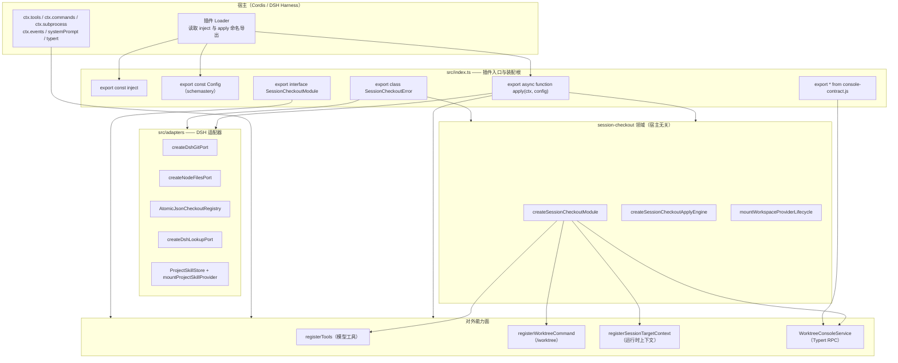
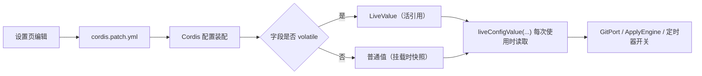
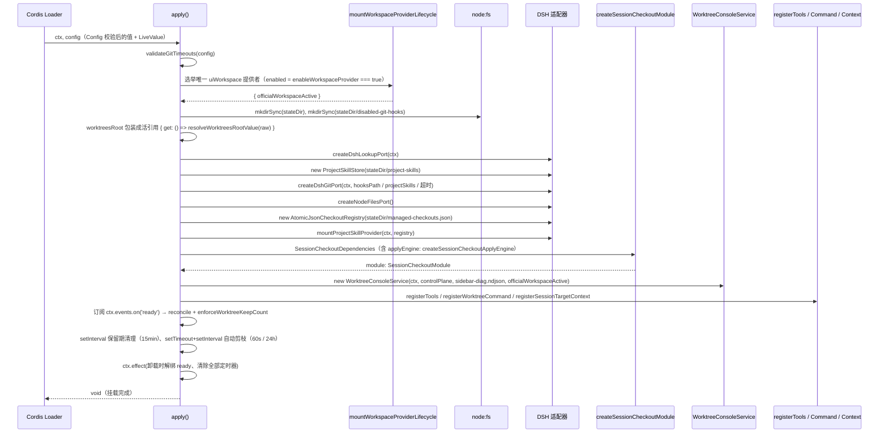
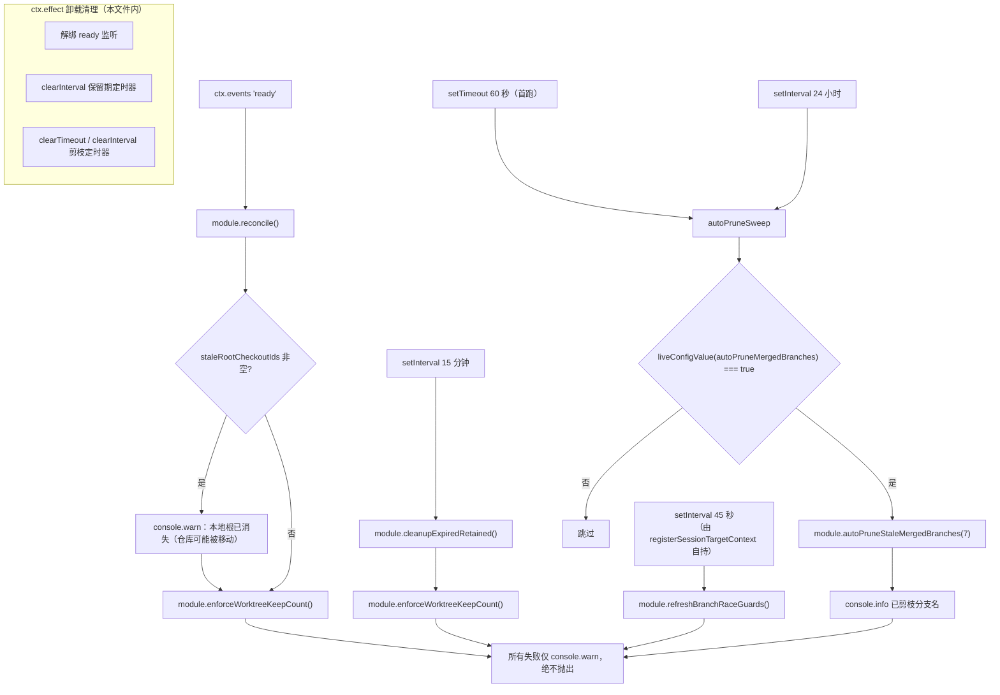
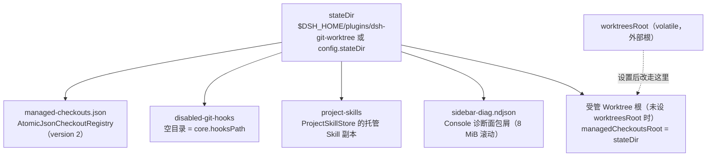
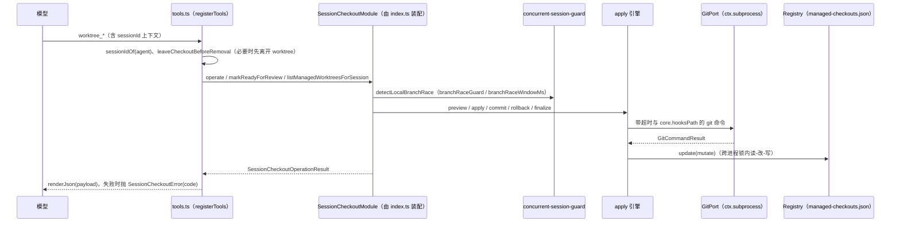
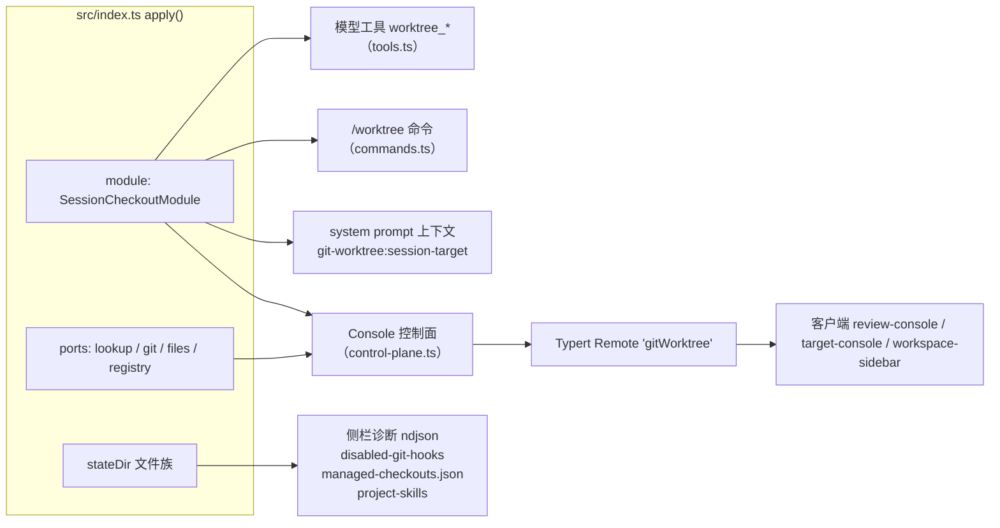

# `src/index.ts` —— dsh-git-worktree 插件入口与装配根

`src/index.ts` 是整个 **dsh-git-worktree** 插件的**入口模块（composition root / plugin face）**。
session-checkout 领域本身（状态机、apply 引擎、端口契约）是从 Domi 移植而来、与宿主无关的纯逻辑；
本文件负责把这套领域逻辑**接入 DeepSeek Harness（DSH）/Cordis 宿主**：

1. 导出领域稳定错误类型 `SessionCheckoutError` 与业务契约接口 `SessionCheckoutModule`；
2. 依据 `Config` schema 接收宿主注入的配置，构建 DSH 适配器（git / files / registry / lookup / project skills）；
3. 用这些适配器实例化 session-checkout 状态机与 apply 引擎；
4. 注册模型可安全调用的 worktree 工具、人类 `/worktree` 验收命令、Session Target 动态运行时上下文；
5. 装配 Console 宿主服务（Typert Remote RPC 面）；
6. 拉起启动收敛（reconcile）与三类后台维护定时器，并在 fiber 卸载时清理。

模块文档级声明：`@module dsh-git-worktree`（见文件顶部注释块）。

- 上层层级：[session_checkout_runtime_entry](session-checkout-runtime-entry.md) → [session_checkout_runtime](session-checkout-runtime.md) → [session_checkout_domain](session-checkout-domain.md) → [core_worktree_domain_and_infrastructure](core-worktree-domain-and-infrastructure.md)
- 同级实现页：[src/session-checkout-module.ts](src-session-checkout-module-ts.md)（状态机实现细节）
- 契约来源页：[session_checkout_domain_contracts](session-checkout-domain-contracts.md)（`ports.ts` / `types.ts`）

---

## 1. 在系统中的位置



要点：`SessionCheckoutError` 与 `SessionCheckoutModule` 定义在入口文件，却被**适配器层**（`src/adapters/git.ts`、`src/adapters/registry.ts`）与**领域层**（`src/session-checkout-module.ts`）反向导入，形成"入口即契约"的依赖方向：契约稳定、实现可替换。

---

## 2. 导出契约一览

| 导出 | 种类 | 作用 | 主要消费者 |
| --- | --- | --- | --- |
| `SessionCheckoutError` | class（`extends Error`，带 `code: SessionCheckoutErrorCode`） | 领域稳定失败，工具层原样透出 `message` | git/files/registry 适配器、状态机、apply 引擎、Console 控制面 |
| `SessionCheckoutModule` | interface | 状态机面向业务调用方的**完整核心接口** | `tools.ts`、`commands.ts`、`session-target-context.ts`、`console-host/control-plane.ts` |
| `SessionCheckoutReconcileSummary` | interface | `reconcile()` 的收敛摘要（需恢复 / 孤儿 / 脏孤儿 / 根消失 / 保留计数） | 启动 `ready` 事件回调、Console 诊断 |
| `ManageManagedWorktreeInput` | interface | 单个受管 Worktree 的管理动作入参 | `manageManagedWorktree*`、Console `retryCleanup/setRetention/...` |
| `ListManagedWorktreesInput` | interface | 列表与清理巡检过滤条件 | `listManagedWorktrees*`、`inspectManagedWorktreeCleanup` |
| `PruneMergedBranchesInput` | interface | 已合并分支剪枝（`dryRun` / `olderThanDays`） | `pruneMergedBranchesForSession`、`autoPruneStaleMergedBranches` |
| `MergeBranchForSessionInput` | interface | 分支合并（`forward` / `reverse`、`dryRun`） | `mergeBranchForSession` |
| `MarkReadyForReviewInput` | interface | 提交"待评审"评审元数据 | `markReadyForReview`、`worktree_ready_for_review` 工具 |
| `IsolatedTargetLaunch` | interface | 隔离目标移交数据，客户端据此创建权威 Workspace/Session | `createIsolatedTarget`、`createPreviewRecoveryHandoff` |
| `inject` | const | Cordis 插件注入清单（Loader 元数据） | Cordis Loader |
| `Config` | schemastery object | 插件配置 schema（含 `volatile` 标记） | 宿主配置装配 + 设置页投影 |
| `apply` | async function | 挂载入口：装配全部组件与后台任务 | Cordis Loader |
| `export * from './console-contract.js'` | 再导出 | 让 `lib/index.d.ts` 单一入口即含 Console RPC 契约 | 客户端 / 远程包 |

> 说明：文件内另有模块级常量 `const name = 'git-worktree'`（`src/index.ts` 第 250 行），只作为本插件在源码中的名称锚点，与 `package.json::name`（`dsh-git-worktree`）及 `WorktreeConsoleService` 的 Remote 命名空间（`super(hostContext, 'gitWorktree')`）属同一命名族；修改插件标识时需三者一起对齐。

### 2.1 `SessionCheckoutError`

```typescript
export class SessionCheckoutError extends Error {
  readonly code: SessionCheckoutErrorCode
  constructor(code: SessionCheckoutErrorCode, message: string) { super(message); this.name = 'SessionCheckoutError'; this.code = code }
}
```

- `code` 取自 `SESSION_CHECKOUT_ERROR_CODES`（见 [session_checkout_domain_contracts](session-checkout-domain-contracts.md) 中的 `types.ts`），是**跨版本稳定的机器可读标识**，调用方（工具层、Console 控制面）按 `code` 而非文本判断分支。
- `message` 是用户可见文本，由 `src/i18n/host.ts` 的 `hostMessage(...)` 生成（见 [src_i18n](src-i18n.md)），工具层**逐字**透出，不做二次改写。

### 2.2 `SessionCheckoutModule` 方法族

按职责分组（完整签名见源文件 `src/index.ts` 第 118–224 行）：

| 分组 | 成员 | 关键约束 |
| --- | --- | --- |
| 观察与运行时上下文 | `inspect`、`runtimeContext(sessionId, cwd?)`、可选 `refreshBranchRaceGuards` | `runtimeContext` **必须同步**：它被注入模型 system prompt，只能读 registry 快照；分支竞态探测由后台定时器预热缓存 |
| 只读预检 | 可选 `preflight`、可选 `preflightPreviewRecovery` | 严格只读：不改 Local、不改 worktree、不写 registry/review/refs |
| 并发与所有权 | `runExclusiveSessionMutation`、`bind` | 与 bind/apply/discard/cleanup 共用**同一把互斥锁**，避免跨模块竞态 |
| 隔离目标生命周期 | `createIsolatedTarget`、`beginNextIteration`、`resumeRevision` | 前者不改动源 Session 的 cwd/身份；后者复用已清理交付者的不可变 cwd；`resumeRevision` 使未同步的评审失效但不触碰 Local |
| 恢复与续作（一次性凭证） | `prepareReviewRegeneration`、`preparePreviewRecoveryAnalysis`、`createPreviewRecoveryHandoff` | 持久化 Host 权威的一次性 continuation / detached 证据，见 [session_checkout_apply_engine](session-checkout-apply-engine.md) |
| 评审与状态机驱动 | `markReadyForReview`、`operate` | `operate(SessionCheckoutOperation)` 是统一的状态机动作入口 |
| 交付开关 | `isAutoDeliverEnabled` | 实时读取 `autoDeliver`；关闭时工具层拒绝模型自主交付 |
| 列表 / 剪枝 / 合并 | `listManagedWorktrees`、`listManagedWorktreesForSession`、`pruneMergedBranchesForSession`、`autoPruneStaleMergedBranches`、`mergeBranchForSession` | 会话作用域方法**永不把持久化的 owner id 当授权**；剪枝遵循 `git branch -d` 语义，绝不强删 |
| 放弃快照（codex 对齐） | `listAbandonedWorktreeSnapshots`、`restoreAbandonedWorktreeSnapshot` | 恢复为 Local 仓库分支并清除记录上的快照标记 |
| 管理与批量清理 | `manageManagedWorktreeForSession`、`inspectManagedWorktreeCleanup`、`bulkCleanupManagedWorktrees`、`manageManagedWorktree` | `inspectManagedWorktreeCleanup` 为主进程持有的只读巡检，不写 registry/refs/目录 |
| 根解析与观测 | `resolveManagedRoot`、`resolveRoots`、可选 `observeManagedCheckout`、可选 `observeManagedCheckouts` | `resolveRoots` 无 Git I/O（用于 cwd 还原）；批量观测在**同一把锁**下完成，结果顺序与请求 `checkoutIds` 对齐 |
| 维护与收敛 | `cleanupExpiredRetained`、`enforceWorktreeKeepCount`、`reconcile` | LRU 逐出豁免 `permanent` 与进行中会话 |

### 2.3 `SessionCheckoutReconcileSummary`

`reconcile()`（启动收敛与手动收敛共用）返回的分类计数，是入口把领域收敛结果"翻译"成运维信号的接口：

| 字段 | 含义 | 入口处的处置 |
| --- | --- | --- |
| `recoveryRequiredCheckoutIds` | 存在未完成 journal / 身份不可验证，需恢复流程的检出 | 由状态机内部继续处理，不在 `apply()` 打印 |
| `orphanedCheckoutIds` | registry 有记录但目录/仓库关系已断（可安全清理） | 同上 |
| `dirtyOrphanedCheckoutIds` | 断链且仍有未提交改动，清理必须人工确认 | 同上 |
| `staleRootCheckoutIds` | 检出所依赖的 **Local 根**消失（仓库被移动/删除） | `apply()` 中非空时 `console.warn` 列出 checkoutId，因为这是唯一需要用户立刻知道的环境级事实 |
| `retainedCheckoutCount` | 当前处于保留（retained）状态的检出数 | 供 LRU/保留期维护参考 |

---

## 3. 配置面：`Config`、`volatile()` 与 `LocalAdaptationConfig`

`Config` 使用 `@deepseek-ai/schemastery` 定义（宿主配置装配读取）。其中 `volatile(schema)` 是一个**元数据标记器**：它把 `meta.volatile = true` 写入 schema，使 Harness 设置宿主（`packages/settings` 的 `schema.ts` 读取 `meta.volatile`）把该字段投影到设置页；设置页的编辑写入仓库根的 `cordis.patch.yml` 且**无需重新挂载插件**，字段值以 `LiveValue<T>`（`{ get(): T }`）的形态到达本模块。



| 字段 | 类型 / 范围 | 默认 | volatile | 语义 |
| --- | --- | --- | --- | --- |
| `stateDir` | string | `$DSH_HOME/plugins/dsh-git-worktree`（`DSH_HOME` 未设时为 `~/.dsh`） | 否 | 插件状态目录：registry、禁用 hooks 根、project-skills、侧栏诊断日志的存放处 |
| `gitTimeoutMs` | 1s … `MAX_GIT_TIMEOUT_MS` | `DEFAULT_GIT_TIMEOUT_MS` | 是 | 普通 git 命令超时（见 [src_adapters](src-adapters.md) 的 `git-options.ts`） |
| `worktreeAddTimeoutMs` | 1s … 1h | 300s | 是 | `git worktree add` 专用超时（大仓库检出慢） |
| `autoDeliver` | boolean | `true` | 是 | Agent 自主交付：Working 态指导语引导模型调用 `worktree_deliver`；关闭时交付只能走 `worktree_ready_for_review` + 人类验收条 |
| `autoPush` | boolean | `true` | 是 | Finish 成功且产生新提交后尽力 `git push` Local 分支（绝不 force），失败只报告不阻塞 |
| `worktreesRoot` | string | 未设 | 是 | 受管 Worktree 根：`<worktreesRoot>/<project>/<topic>-<YYYYMMDD>`，应位于任何 Git 检出之外 |
| `inheritLocalChanges` | boolean | `true` | 是 | 创建 Worktree 时继承本地未提交修改（tracked 打补丁 + 未 ignore 的 untracked 复制），仅当基点与本地 HEAD 一致时生效，失败降级为告警 |
| `worktreeKeepCount` | 0 … 500 | 15 | 是 | 受管 Worktree 总量上限（按最近更新时间的 LRU 逐出已交付记录），`0` 关闭 |
| `autoPruneMergedBranches` | boolean | `false` | 是 | **唯一**在无逐次用户确认下删除分支的机制：启动 60 秒后对每个受管项目执行真实 `git branch -d` |
| `branchRaceGuard` | boolean | `true` | 是 | 并发分支竞态守卫：其他活跃 Session 共享 Local 且窗口内出现新本地分支时，指示后启动的 Session 先 `worktree_create` 隔离 |
| `branchRaceWindowMs` | 60s … 24h | 30min | 是 | 上述守卫的检测窗口 |
| `enableWorkspaceProvider` | boolean | `false` | 否 | 接管官方 Workspace UI（`ui-workspace`）。仅显式 `true` 才接管：禁用官方条目会把其 client 包从 Host 客户端图移除 |

`LocalAdaptationConfig` 是 `apply()` 形参用到的**本地适配视图类型**（未导出）：除 `enableWorkspaceProvider` 外，每个字段都写成 `boolean | LiveValue<boolean | undefined>` 之类的联合类型，因此同一处代码既能接受普通配置也能接受活引用，统一由 `liveConfigValue` 解包。

---

## 4. 源码分区与阅读顺序

本文件的书写顺序刻意把**契约放在实现之前**（先 export 类型与接口，再 import 运行期依赖），阅读时可按以下分区定位：

| 行区间 | 分区 | 内容 |
| --- | --- | --- |
| 1–38 | 前置 import 与模块注释 | `ProjectSkillStore` / `mountProjectSkillProvider` 的提前导入；`@module dsh-git-worktree` 注释；`ports.js` / `types.js` 的纯类型导入 |
| 40–115 | 契约层（export） | `SessionCheckoutError`、`SessionCheckoutReconcileSummary`、四个 `*Input`、`MarkReadyForReviewInput`、`IsolatedTargetLaunch` |
| 117–224 | 核心接口 | `SessionCheckoutModule`（状态机对业务调用方的完整面） |
| 226–248 | 运行期 import 与再导出 | 适配器、领域工厂、注册函数、Console 宿主；`export * from './console-contract.js'` |
| 250–258 | Loader 元数据 | `const name`、`export const inject` |
| 260–342 | 配置层 | `volatile()`、`export const Config`、`interface LocalAdaptationConfig` |
| 344–359 | 配置解析辅助 | `resolveWorktreesRootValue`、`resolveStateDir`、四个后台任务节律常量 |
| 361–473 | 装配 | `export async function apply(...)` |

> 契约前置的一个直接后果：`session-checkout-module.ts` 既 `import { SessionCheckoutError } from './index.js'`（值导入），又 `import type { SessionCheckoutModule, ... } from './index.js'`（类型导入）。入口因此在模块图中同时扮演"契约提供者"和"装配者"。

## 4. 挂载流程：`apply(ctx, config)`



### 4.1 装配顺序的因果约束

1. **`validateGitTimeouts` 最先**：`gitTimeoutMs` / `worktreeAddTimeoutMs` 越界直接抛 `RangeError`，把失败留在挂载期而非首次 git 调用。
2. **Workspace 选举早于服务挂载**：官方 `ui-workspace` 条目的 disable/restore 由 Host 侧 Loader 操作决定，其结果 `officialWorkspaceActive` 需作为构造参数传入 `WorktreeConsoleService`，供侧栏拓扑响应如实报告"谁在提供 Workspace"。选举细节见 [workspace_provider_lifecycle](workspace-provider-lifecycle.md)。
3. **目录先于适配器**：`stateDir` 与 `disabled-git-hooks` 必须先存在，git 端口才能以 `core.hooksPath` 指向空目录（受管 Worktree 永不跑用户 hooks）。
4. **registry 先于 skill provider**：`mountProjectSkillProvider(ctx, registry)` 需要注册表来判定"哪个 cwd 落在某个 `phase === 'ready'` 的托管根内"，从而只对该根追加项目 Skill 源。
5. **module 是所有能力面的唯一上游**：工具、命令、上下文、Console 控制面都只依赖 `SessionCheckoutModule` 接口，不直接触碰适配器，保证权限与作用域判定集中在状态机内。

### 4.2 后台任务与生命周期



设计意图要点：

- **`unref?.()`**：本文件自管的三个定时器（保留期 1 个、剪枝 2 个）都解除 Node 引用，宿主进程退出不会被插件后台任务拖住。竞态守卫刷新的 45 秒定时器由 `registerSessionTargetContext` 自行注册与清理，属于另一个 `ctx.effect`。
- **首次剪枝提前 60 秒**：重启频繁的宿主也能做到每天一次扫掠。
- **剪枝开关每次读取活引用**：`autoPruneMergedBranches` 关掉后下一轮扫掠立即停止，无需重装。
- **竞态守卫缓存与 prompt 同步性分离**：`runtimeContext` 必须同步，因此 reflog 探测放到 45 秒的后台周期里（实现在 `src/session-target-context.ts`，见 [workspace_provider_lifecycle](workspace-provider-lifecycle.md)）。
- **`reconcile` 失败只告警**：启动收敛不能因单条损坏记录阻断整个应用启动（状态机内部还有 `CHECKOUT_CLEANUP_TIMEOUT_MS` 兜底，见 [src_session-checkout-module.ts](src-session-checkout-module-ts.md)）。

### 4.3 状态目录布局（`apply()` 建立的文件族）



`stateDir` 同时作为 `SessionCheckoutDependencies.managedCheckoutsRoot` 传入状态机：它是**托管 Worktree 的默认落点**，一旦配置了 `worktreesRoot` 就改由后者承载目录布局（`<worktreesRoot>/<project>/<topic>-<YYYYMMDD>`），但 registry 与 hooks 根始终留在 `stateDir`。

---

## 5. 关键数据流：一次模型工具调用如何穿过装配层



授权与并发相关的两处入口级约束（均由本文件选定的适配器组合决定）：

- **caller-scoped 方法**（`*ForSession`）永不把持久化的 `ownerSessionId` 当授权证据；
- **`runExclusiveSessionMutation`** 让跨模块写操作复用与 bind/apply/discard/cleanup 相同的互斥队列（锁实现见 [src_session-checkout-module.ts](src-session-checkout-module-ts.md)）。

---

## 6. 入口层建立的安全不变量

本文件本身不含业务判断，但它的**装配选择**决定了以下几条系统级不变量能否成立；改动装配代码时必须逐条自检：

| 不变量 | 由装配的哪一步保证 | 破坏后的表现 |
| --- | --- | --- |
| 受管 Worktree 内永不执行用户 git hooks | `mkdirSync(hooksPath)` + `hooksPath` 注入 `createDshGitPort`（空目录作为 `core.hooksPath`） | 模型在隔离环境里触发仓库自带的 pre-commit/commit-msg，交付被无关脚本阻断或篡改 |
| 插件内部 ref 不与用户 ref 冲突 | git 端口使用 `refs/dsh-worktree/session-checkouts/<key>` 命名空间（适配器内实现，装配处提供 `projectSkills`/`hooksPath` 上下文） | 清理/恢复写入覆盖用户分支或标签 |
| 托管 Skill 只对**已验证**的托管根生效 | `registry` 先建、`mountProjectSkillProvider(ctx, registry)` 后挂，root 由注册表 + `.git` 反向链接校验得出，绝不采信 Skill 文件自报的 root | 任意 cwd 下的 `CLAUDE.md`/skills 被当作项目 Skill 注入 |
| 后台维护永不阻断启动 | `reconcile` 走 `ready` 事件 + 全链 `.catch(console.warn)`；三个定时器 `unref?.()` | 一条损坏记录把宿主启动拖入无限等待 |
| 跨进程写 registry 不丢更新 | 只经 `AtomicJsonCheckoutRegistry`，且单记录更新一律走 `update(mutate)`（锁内读-改-写） | 两个进程各自 read-modify-write 互相覆盖 |
| 模型侧交付受开关约束 | `isAutoDeliverEnabled()` 实时读取 `autoDeliver` 活引用 | 用户关掉自主交付后模型仍能 `worktree_deliver` 落库 |
| 自动删除分支只有一条路径 | `autoPruneSweep` 的 `=== true` 严格判等 + `git branch -d` 语义（绝不 `-D`） | 未合并的工作分支被静默删除 |
| 客户端与 Host 的 Workspace 提供者唯一 | `mountWorkspaceProviderLifecycle` 的选举结果传入 `WorktreeConsoleService` | 两个 `uiWorkspace` 提供者并存或一个都没有，Web 启动崩溃 |

---

## 7. `inject` 与 Loader 元数据

```typescript
export const inject = { tools: {}, commands: {}, subprocess: {}, loader: { await: false } }
```

- 必须是**命名导出**：Loader 以 `inject` / `apply` 命名导出识别插件元数据；若只导出裸函数，插件将以"无注入清单"挂载，随后第一次访问 `ctx.tools` 就会失败（"cannot get property without inject"）。
- `subprocess` 是 git 端口的执行底座（`createDshGitPort` 通过 `ctx.subprocess` 获得树状终止、有界输出、净化环境）。
- `loader: { await: false }` 让挂载不等 Loader 排空。
- `workingDirectory` **有意不出现在清单里**：宿主若挂载该服务（桌面 shell、官方实验性 `create_worktree` bundle）则 `worktree_create` 能真正把 Session 移入检出；老宿主下适配器动态解析得到 `undefined`，退回"仅指导"行为。适配器细节见 [src_adapters](src-adapters.md) 的 `working-directory.ts`。

---

## 8. 构建与发布关联

本入口对应发布产物 `lib/index.js` 与类型 `lib/index.d.ts`（`package.json` 的 `main` / `types` / `exports["."]`）。

| 关注点 | 来源（仓库根文件） | 说明 |
| --- | --- | --- |
| `build` = `node scripts/clean-lib.mjs && tsc && tsdown` | `package.json`（scripts） | `tsc` 产出 `lib/index.js` + 类型；`tsdown` 只打包客户端 bundle（入口为 `src/client/console-remote/index.ts`，见 `tsdown.config.ts`），故服务端 `apply` 逻辑不经 bundler 改写 |
| 导出子路径 `./console-contract` | `package.json`（exports） | 与本文件 `export * from './console-contract.js'` 呼应，宿主与客户端可从任一入口取到同一契约类型 |
| CI 门禁 | `.github/workflows/ci.yml`（job `check`） | `typecheck` → `build` → `check:publish:release` → `test`，入口的 schema/类型改动必须全链通过 |
| 运行时要求 | `package.json`（engines）：`node ^22.19.0 \|\| >=24.0.0` | 入口大量使用 `node:crypto` / `node:fs` / `node:path` 同步 API 与 `.js` 后缀 ESM 说明符 |
| 插件条目注册 | `cordis.patch.yml` | 把 `dsh-git-worktree` 插入宿主 profile；其历史注释记录了 Workspace 接管选举从"client 侧条件表达式"改为"Host 侧 Loader 操作"的原因 |

---

## 9. 组件依赖清单（入口直接 import/export）

| 依赖 | 来自 | 用途 | 详细文档 |
| --- | --- | --- | --- |
| `createDshGitPort`、`createNodeFilesPort`、`AtomicJsonCheckoutRegistry`、`createDshLookupPort`、`ProjectSkillStore`、`mountProjectSkillProvider` | `src/adapters/*` | 构建 `SessionCheckoutDependencies` 的四类端口实现 | [src_adapters](src-adapters.md) |
| `DEFAULT_GIT_TIMEOUT_MS`、`MAX_GIT_TIMEOUT_MS`、`validateGitTimeouts`、`GitTimeoutOptions` | `src/adapters/git-options.ts` | 配置校验与超时默认值来源 | [src_adapters](src-adapters.md) |
| `createSessionCheckoutModule`（含 `ResolvedSessionProject` 等） | `src/session-checkout-module.ts` | 状态机实例，即 `SessionCheckoutModule` 实现 | [src_session-checkout-module.ts](src-session-checkout-module-ts.md) |
| `createSessionCheckoutApplyEngine` | `src/session-checkout-apply.ts` | Preview/Apply/Checkpoint/Finish 引擎 | [session_checkout_apply_engine](session-checkout-apply-engine.md) |
| `mountWorkspaceProviderLifecycle`、`hostWorkspaceClientFlavor` | `src/workspace-provider-lifecycle.ts`、`src/host-compat.ts` | 宿主代际判定与 `uiWorkspace` 唯一提供者选举 | [workspace_provider_lifecycle](workspace-provider-lifecycle.md)、[worktree_core_operations](worktree-core-operations.md) |
| `registerTools`、`registerWorktreeCommand` | `src/tools.ts`、`src/commands.ts` | 模型工具面、人类命令面（二者内部再经 `adapters/working-directory.ts` 移动 Session cwd） | [worktree_core_operations](worktree-core-operations.md) |
| `registerSessionTargetContext` | `src/session-target-context.ts` | 动态 system prompt 上下文 + 竞态守卫刷新定时器 | [workspace_provider_lifecycle](workspace-provider-lifecycle.md) |
| `createWorktreeConsoleControlPlane`、`createGitWorktreeReviewDiffReader`、`WorktreeConsoleService` | `src/console-host/*` | Host 侧 RPC 控制面与评审 diff 读取 | [worktree_console_host](worktree-console-host.md) |
| `liveConfigValue`、`LiveValue`、`GitCheckoutSnapshot`、各类 continuation 类型 | `src/ports.ts` | 活引用解包与端口契约类型 | [session_checkout_domain_contracts](session-checkout-domain-contracts.md) |
| 视图类型（`SessionTargetView`、`ManagedWorktreeSummaryView`、`WorktreeApplyPreflightView` 等） | `src/types.ts` | `SessionCheckoutModule` 的返回类型 | [session_checkout_domain_contracts](session-checkout-domain-contracts.md) |
| `SessionCheckoutErrorCode`、`SESSION_CHECKOUT_ERROR_CODES` 家族 | `src/types.ts` | `SessionCheckoutError.code` 的取值域 | [session_checkout_domain_contracts](session-checkout-domain-contracts.md) |
| `@deepseek-ai/schemastery`（`z`）、`@deepseek-ai/cordis`（`Context` 类型） | 外部 | 配置 schema 与宿主上下文类型 | [build_ci_and_packaging](build-ci-and-packaging.md) |

---

## 10. 下游能力面（谁使用本入口装配出来的对象）



客户端侧如何消费这些契约，见 [worktree_client_interface_layer](worktree-client-interface-layer.md)；RPC 契约与描述符见 [worktree_console_contract](worktree-console-contract.md)。

---

## 11. 修改本模块时的注意事项

1. **不要在入口做 Git/文件系统重活**：`apply()` 是宿主启动路径，`reconcile` 等必须留给 `ready` 事件与定时器；任何新的启动工作都要像现有三处那样"失败仅告警、不抛"。
2. **新增可调字段要走 `volatile()`**：否则该字段只能在重装插件后生效；同时把对应 `LocalAdaptationConfig` 字段写成 `T | LiveValue<T | undefined>` 并在读取处用 `liveConfigValue`，才能让设置页编辑立即生效。
3. **新增 `SessionCheckoutModule` 方法要区分可选性**：`preflight`、`observeManagedCheckout(s)`、`refreshBranchRaceGuards` 等写成可选成员，是因为并非所有宿主/代际都能提供其前提；调用方（尤其 Console 控制面）必须做存在性判断。
4. **状态目录布局是兼容面**：`stateDir` 下的 `managed-checkouts.json`、`disabled-git-hooks`、`project-skills`、`sidebar-diag.ndjson` 均有既有数据；改名或挪动会破坏升级路径（registry 有版本校验与保守迁移，见 [src_adapters](src-adapters.md)）。
5. **Workspace 接管是高风险开关**：`enableWorkspaceProvider` 只在显式 `true` 时接管，原因写在源码注释与仓库根 `cordis.patch.yml` 的历史说明中——禁用官方条目会移除被其他 UI 包导入的 client 包，导致整片 bundle 加载失败。
6. **`SessionCheckoutError` 位置固定**：它定义在本文件而被 `adapters/` 与领域层导入；把它挪到 `types.ts` 会引入入口 → 类型 → 实现的循环依赖风险。
