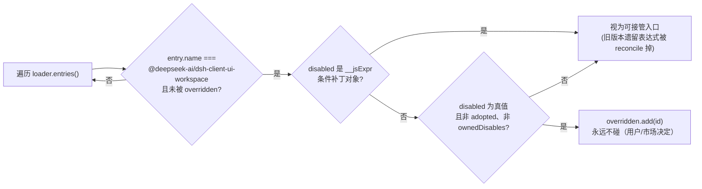
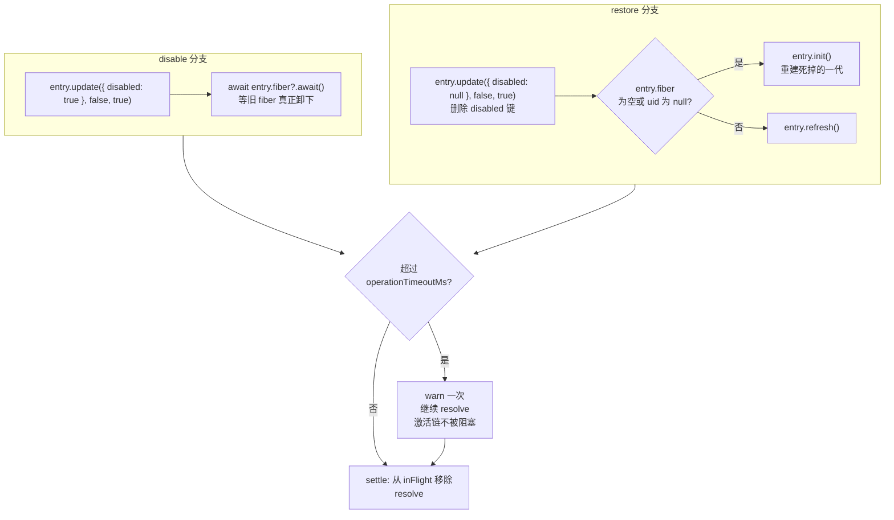
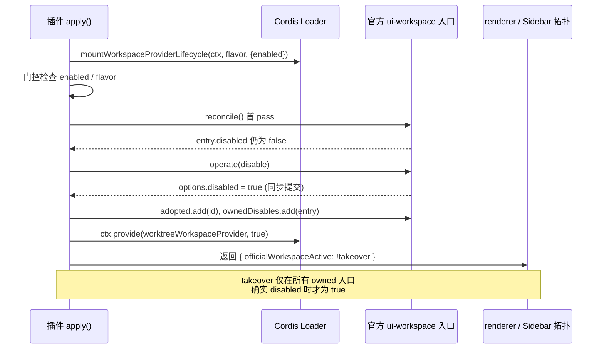
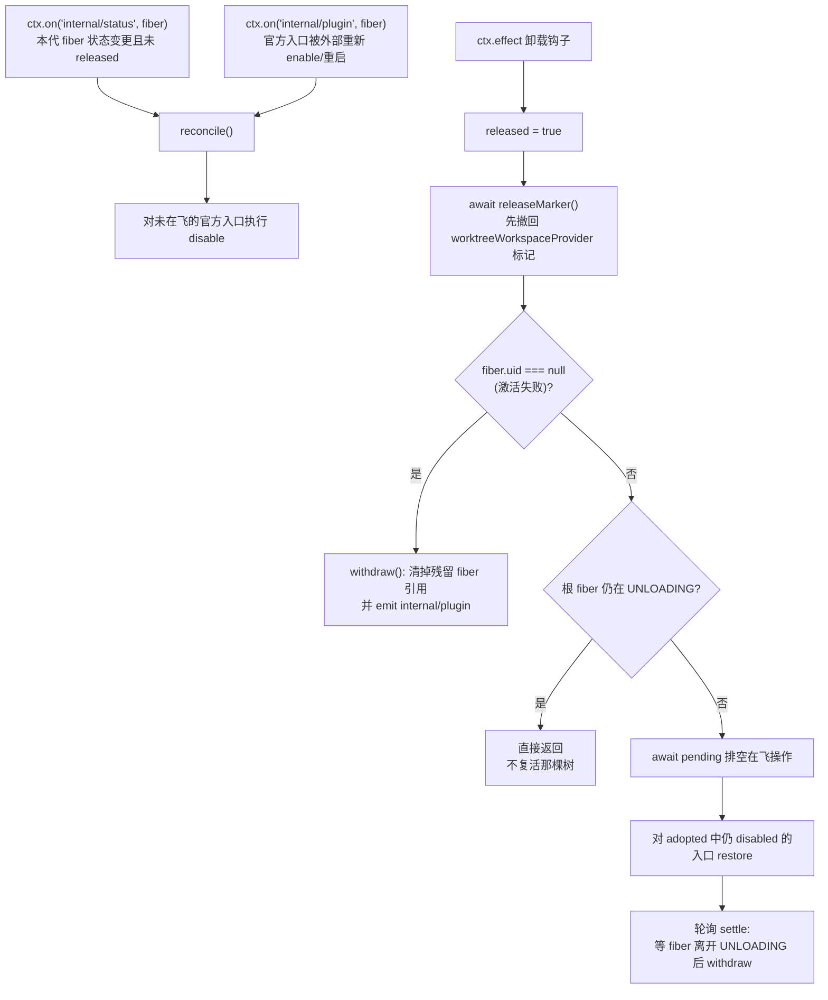
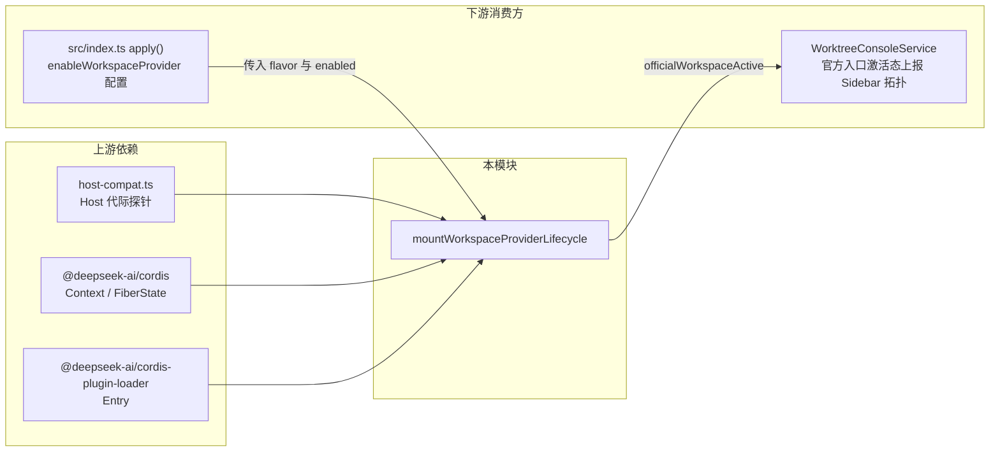

# 工作区 Provider 生命周期

本模块负责在 Host（dsh-agent）侧完成「官方 `ui-workspace` 入口与本插件受管 Workspace Provider 之间二选一」的选举（takeover）：通过 Cordis Loader 的 `entry.update({ disabled: true })` / `entry.update({ disabled: null })` 操作，确定性地禁用或恢复官方入口 `@deepseek-ai/dsh-client-ui-workspace`，并在插件 fiber 卸载时回滚全部变更。它是插件启动序列中最先执行的环节之一（见 `src/index.ts` 的 `apply()`），其结果 `officialWorkspaceActive` 随后被注入 [控制台宿主](../console_control_plane_and_services/console_host.md)，用于 Sidebar 拓扑投影的真实上报。

源码位置：[`src/workspace-provider-lifecycle.ts`](../../repo/src/workspace-provider-lifecycle.ts)

## 为什么需要这个模块

早期版本用条件补丁（`disabled: !!get('worktreeWorkspaceProvider') && ...`，即 `__jsExpr` 表达式）做选举。该表达式在两个不同步的时刻被求值：

- 插件 Host apply 阶段，插件 fiber 仍处于 LOADING，Cordis 严格 service 读取返回 `undefined`，选举始终失败（只能 decorate 共存）；
- Web 渲染器后续审计时插件已 ACTIVE，同一表达式被求值为 `true`，跳过官方入口。

结果是渲染端不再拥有任何 `uiWorkspace` Provider，直接撑爆 0.2.x 的 Web 启动（2026-10-17 的两次崩溃事故，各有 17 个入口 pending）。本模块因此把选举收敛到 Host 侧一次性决策：写入的是普通布尔值，后续所有读取（Host 审计、序列化渲染树、模块事件）都是确定的，不再依赖表达式求值时机。

## 核心组件

| 组件 | 角色 |
| --- | --- |
| `mountWorkspaceProviderLifecycle(ctx, flavor, options)` | 主挂载函数：完成首pass 选举、注册 effect 清理钩子与 Loader 事件重入，返回真实选举结果 |
| `WorkspaceProviderLifecycleOptions` | 调优接缝，目前仅 `operationTimeoutMs`（单次 Loader 操作的超时上限，默认 10 000ms） |
| `WorkspaceProviderLifecycleResult` | 选举结果，唯一字段 `officialWorkspaceActive`；仅当本插件真正禁用了所有官方入口（takeover）时为 `false` |
| `Context`（声明合并） | 通过 `declare module '@deepseek-ai/cordis'` 在全局 `Context` 上注入 `worktreeWorkspaceProvider: boolean`，由 `ctx.provide('worktreeWorkspaceProvider', true)` 发布 |

辅助常量与模块级状态：

- `OFFICIAL_WORKSPACE = '@deepseek-ai/dsh-client-ui-workspace'` —— 被选举对象；
- `DEFAULT_OPERATION_TIMEOUT_MS = 10_000` —— 单次 disable/restore 的天花板，防止 Loader 卡死拖垮插件激活链；
- `ownedDisables = new WeakSet<Entry>()` —— **跨代所有权记录**：Entry 对象在插件多次重启之间被复用，重启后新生 lifecycle 的 `adopted` 集合为空，必须靠 WeakSet 认出「这个 pending disable 是我们自己上一代写的」，而不是用户或市场的决定；
- `adopted` / `overridden`（按 entry id）—— 本代禁用的入口 / 首次见到时已被外部禁用的入口，后者永远不碰。

## 前置门控

函数在执行任何 Loader 操作前依次检查两道门：

1. **`options.enabled`**：由插件 Config 的 `enableWorkspaceProvider`（默认 `false`，见 [插件入口](worktree_lifecycle_management_core_index.md) 的 Config schema）传入。legacy 0.1.x Host 上 takeover 曾破坏「新建会话」流程，因此默认不接管；不满足时直接返回 `{ officialWorkspaceActive: true }`。
2. **`flavor !== 'unsupported'`**：Host 代际探针（详见 [Host 兼容代际](host_compat.md)）判断当前 dsh-agent 版本是否有 pinned 的 Workspace Browser；不满足时同样放行官方入口。

在 modern 0.2.x Host 上，takeover 实际上是结构性必需：decorated 注册拿不到官方 Browser 的 child-slot 席位（0.2.x 的 Browser 对声明的 child slot 调用 `renderSlot`，缺失即崩 `renderSlot is not a function`，连带会话行与新建会话的 Workspace 选择面板）。

## 所有权模型

关键不变量：

- 只有「本次禁用操作真的把 `options.disabled` 提交为 `true`」的入口才会进入 `adopted` / `ownedDisables`；卡住或失败的操作保持「非我所有」，留给后续 Loader 事件重试。
- `selfDisabled()` 检查插件自身入口是否已被市场/持久化禁用——市场在入口 bundle 一出现就回放持久化禁用列表，选举可能在本插件尚未激活时被外部禁用；此时选举直接让位并等待 `internal/plugin` 事件重入。

## 操作执行与超时天花板

`operate(entry, 'disable' | 'restore')` 封装单次 Loader 操作，并处理 Loader 1.0.6 的两个行为修正：

设计要点：

- **永不阻塞激活**：Host 并发启动入口，官方入口的 disable 可能与仍在启动的 fiber 竞争；Loader 各版本对这种 dispose 的 settle 行为不一致，因此每个操作都与超时天花板赛跑，卡住的操作只告警一次，入口保持受保护直到真实操作 settle，下一个 Loader 事件再重试。
- **每入口至多一个在飞操作**：`inFlight` 集合让后续 reconcile 跳过尚未 settle 的入口。
- **restore 必须 init 而非 refresh**：Loader 1.0.6 的 `update()` 不 await 地 dispose fiber 并把死掉的 fiber 留在 entry 上，`refresh()` 会把残留引用当作仍在运行；只有 `init()` 能替换死去的一代。

## 选举循环（reconcile）与结果判定

首 pass 在 `apply()` 返回前 settle，保证 Sidebar 拓扑上报真实结果。结果判定必须逐入口复核 `entry.disabled`：

- 若任一 owned 入口仍未禁用（含 inFlight 未 settle），`takeover = false`，回退到「decorated 共存」安全路径——这会避免 Web 客户端重演官方 apply 时撞上 `service "uiWorkspace" has been registered` 的崩溃（2026-10-11 事故）。

## 重入与卸载清理

清理顺序的细节均来自真实 Loader/Cordis 版本的行为修正：

- Cordis 4.0.5 的 effect 卸载是并发而非 LIFO，所以标记撤回必须显式排在恢复官方入口之前；
- Loader 1.0.6 把失败/已 dispose 的 fiber 留在 entry 上，而 Web registry 只检查引用是否存在——本代卸载必须清掉残留引用并发布 registry 消费的 `internal/plugin` 事件；
- 重启复用 live fiber（`uid !== null`），干净卸载不能清引用；激活失败 fiber 的 `fiber.await()` 会在残留 transition 上空转（2026-10-24 Windows 实测），所以只在 fiber 离开 UNLOADING 后才 withdraw；
- Root/Include 拆卸时拥有这些入口，不能在根仍在 UNLOADING 时复活那棵树。

## 与其他模块的关系

- **[Host 兼容代际](host_compat.md)**：提供 `WorkspaceClientFlavor`，决定本模块是否需要执行接管。
- **[插件入口与模块契约](worktree_lifecycle_management_core_index.md)**：`apply()` 中的配置 `enableWorkspaceProvider` 与 `hostWorkspaceClientFlavor()` 是本模块唯一的外部输入。
- **[控制台宿主](../console_control_plane_and_services/console_host.md)**：`providerLifecycle.officialWorkspaceActive` 被传入 `WorktreeConsoleService`，决定 Sidebar 拓扑响应如何向客户端描述当前 Workspace Provider 的归属。
- **共享契约中的 Sidebar 类型**（[console 契约](../shared_contracts_and_domain_ports/core_types_and_ports.md) 的 `WorktreeSidebarTopologyResponse` 等）：是该结果在客户端侧的投影出口，本模块不直接构造。

## 关键设计不变量小结

1. 选举决策只有一次、在 Host 侧；写入的是普通布尔值，杜绝表达式求值竞态。
2. 本插件的激活永远不会被单次 Loader 操作拖垮或卡死（超时天花板 + 告警 + 重入）。
3. 只有自己禁用的入口（`adopted` + `ownedDisables`）才会被恢复；外部禁用的入口始终让位。
4. takeover 只在逐入口复核后才声明，否则安全回退 decorated 共存——宁可双 Provider 共存，也不能没有 Provider。
5. 跨代所有权用 WeakSet 记录在共享的 Entry 对象上，重启后新生 lifecycle 不会把上代的 pending disable 误判为外部决定。
