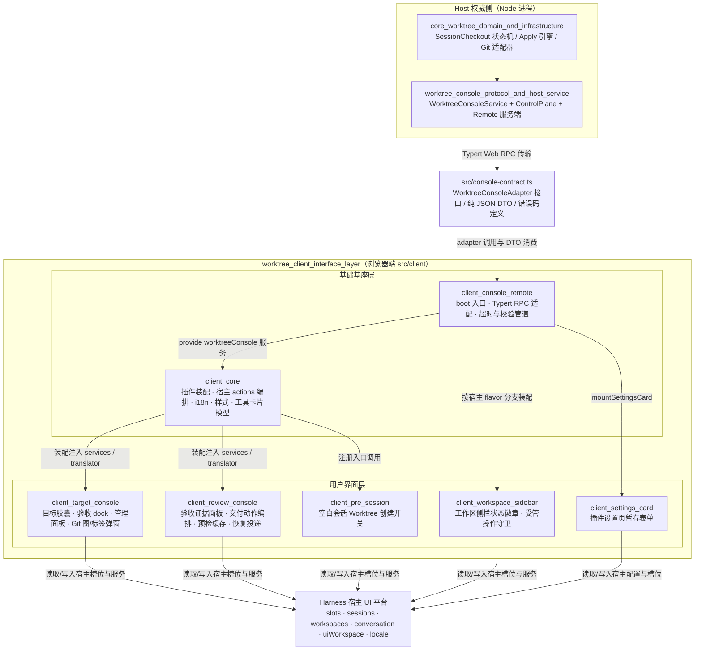

# worktree_client_interface_layer：Worktree 浏览器端客户端界面层总览

本模块是 dsh-git-worktree 插件全部浏览器端用户界面的集合，对应源码路径 `src/client/`。作为连接 Node 端 Host 权威域与 Harness 宿主 UI 平台的薄适配层，本层不承担任何 Git 操作、worktree 状态机推进、权限校验或冲突判定职责——所有业务权威逻辑均在 Host 侧完成，客户端仅负责 DTO 投影、用户操作编排、宿主版本适配与回放稳定的 UI 渲染。

## 模块核心职责
- 浏览器 bundle 入口装配与 Remote 传输适配，统一封装超时控制、错误归一化、strict 响应校验
- 宿主服务（sessions、workspaces、conversation、uiWorkspace、locale）的版本差异适配与导航编排
- 所有用户可见 Worktree 界面的渲染：目标控制台、验收控制台、预会话开关、工作区侧栏、设置卡片
- 历史工具调用卡片的回放稳定模型，保证旧会话打开时的渲染结果与操作时一致，不依赖任何实时状态
- 统一的客户端本地化、作用域样式体系与跨界面刷新事件广播
- 全链路的优雅降级：在 Host 能力缺失时仍保证历史会话可正常回放，不出现整体崩溃

## 整体架构

层与 Host 侧的唯一接缝是 `WorktreeConsoleAdapter` 契约，所有跨进程调用的错误归一化、身份校验、重试逻辑都在该接缝之后完成，界面组件从不直接接触 RPC 层对象。所有写操作都遵循「只读预检先于写入」原则，UI 层不本地持有任何业务权威值，Host 返回的 CAS 身份是所有变更操作的唯一依据。

## 核心组件文档
- [client_core](client-core.md)：客户端界面层根模块，负责插件入口装配、回放稳定的 ToolView 模型、宿主运行时操作编排、本地化与样式基座，是所有子模块的依赖汇聚点。
- [client_console_remote](client-console-remote.md)：浏览器 bundle 启动入口与 Remote 传输适配层，把 Host 侧 Typert RPC 方法包装为统一的 `WorktreeConsoleAdapter`，实现双档超时、错误归一化与 strict 响应校验。
- [client_target_console](client-target-console.md)：会话目标控制台，渲染会话头部目标胶囊、composer 上方的验收状态 dock、工作树管理面板、提交图与标签管理弹窗，内置共享的目标状态轮询与分支总览缓存。
- [client_review_console](client-review-console.md)：受管 Worktree 验收控制台，负责验收证据展示、只读预检、交付动作编排与分离态恢复请求的持久化排队投递。
- [client_pre_session](client-pre-session.md)：空白会话「在 Worktree 中开始」开关，支持在会话创建前直接迁移草稿与附件到隔离工作树会话，内置 scope 失效守卫与原子交接流程。
- [client_workspace_sidebar](client-workspace-sidebar.md)：工作区侧边栏集成模块，在原生工作区会话行展示受管 worktree 状态徽章，提供受管操作的突变守卫，支持接管与装饰两种宿主兼容模式。
- [client_settings_card](client-settings-card.md)：插件设置页，以暂存表单形式编辑插件易失配置，支持带 revision 围栏的安全写入。