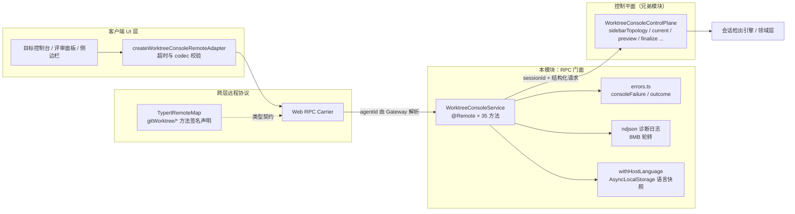
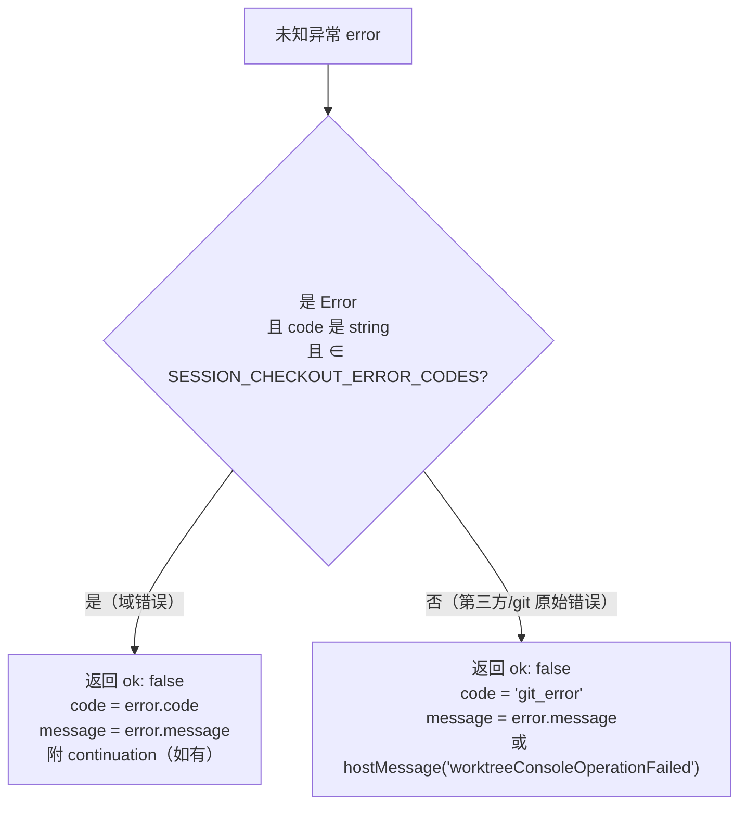
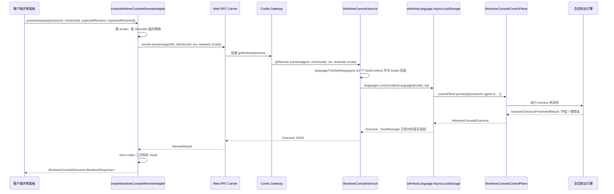
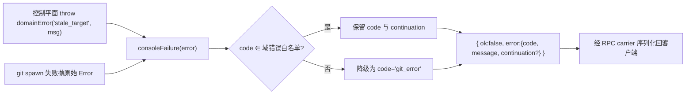

# Worktree 控制台宿主服务 RPC 门面

## 简介

`Worktree_Console_Host_Service_RPC_Facade` 是宿主侧（Host 进程）暴露给客户端 UI 的 **Typert Remote 服务门面层**。它的职责不是实现业务逻辑，而是：

1. 以 `gitWorktree` 命名空间把宿主能力注册为合法的远程过程调用（RPC）方法；
2. 为每个 RPC 调用绑定 **按次的语言环境快照**（通过 `withHostLanguage` / `languageFromSettings`），使宿主消息翻译与调用方客户端的 locale 一致；
3. 把业务异常统一归一化为 `WorktreeConsoleOutcome<T>` 结构化结果（`ok` / `error.code` / `error.message` / `continuation`）；
4. 以 **ndjson 诊断日志**（带 8 MB 轮转上限）记录高频调用（如顶部胶囊每 5 秒轮询的 `current`）的耗时与成败，支撑「慢在哪」的事后排查。

本模块由两个文件构成：

| 文件 | 导出符号 | 角色 |
| --- | --- | --- |
| `src/console-host/service.ts` | `WorktreeConsoleService` | Typert Remote 服务类，35 个 `@Remote` 方法，逐条委派给控制平面 |
| `src/console-host/errors.ts` | `consoleFailure`、`domainError`、`failure`、`outcome` | 域错误构造与 Outcome 归一化工具 |

业务语义（worktree 生命周期、预检、回滚、交付、Git 分支/标签管理）全部位于兄弟模块 [控制平面](worktree-console-host-service-control-plane.md) 中，本层只做「翻译 + 归一化 + 观测」。

---

## 架构定位



**关键点**：`WorktreeConsoleService` 继承自 `TypertRemoteService`，构造时以 `'gitWorktree'` 命名空间注册到 Cordis `Context`。Gateway 在业务代码运行前已把调用方的 `agentId` 解析为 `Agent` 实例，因此每个 `@Remote` 方法的第一个参数就是 `agent: Agent`，其 `agent.id` 天然就是「会话身份」，无需从请求体重复传递。

---

## 组件详解

### 1. `WorktreeConsoleService`（`src/console-host/service.ts`）

#### 构造函数

```typescript
constructor(
  private readonly hostContext: Context,
  private readonly controlPlane: WorktreeConsoleControlPlane,
  private readonly diagFile?: string,
  private readonly officialWorkspaceActive = true,
)
```

| 参数 | 用途 |
| --- | --- |
| `hostContext` | Cordis 宿主上下文；当 RPC 方法未注入 `Agent.ctx` 时作为语言设置回退源 |
| `controlPlane` | 所有业务方法的委派目标，接口定义见控制平面模块 |
| `diagFile` | 可选的 ndjson 诊断文件路径；缺省时 `appendDiag` 立即返回（best-effort） |
| `officialWorkspaceActive` | 来自 `mountWorkspaceProviderLifecycle` 的 Provider 选举结果；`true` 表示官方 Workspace 仍在线，会随 `sidebarTopology` 下发给客户端 |

#### 统一方法模板

除 `sidebarTopology` / `clientBootReport` 外，其余 33 个方法严格遵循同一模板：

```typescript
@Remote
async someOp(agent: Agent, /* 业务参数 */, locale?: Language): Promise<WorktreeConsoleOutcome<X>> {
  return withHostLanguage(
    locale ?? languageFromSettings(agent.ctx ?? this.hostContext),
    () => this.controlPlane.someOp({ sessionId: agent.id, /* 业务参数 */ }),
  )
}
```

这个模板做了三件事：

1. **locale 消解优先级**：客户端显式传入的 `locale` → 当前 `Agent.ctx` 中的 DSH 设置 `settings.locale.preference` → 全局 `hostContext` → `normalizeLanguage` 的默认值（`zh`）。
2. **AsyncLocalStorage 隔离**：`withHostLanguage` 把 locale 快照存入 `AsyncLocalStorage`，控制平面内部所有 `hostMessage(key)` 调用都能读到，且跨异步 continuation 不泄漏。
3. **会话身份绑定**：`agent.id` 被打包为 `sessionId` 放进控制平面的请求对象，RPC 参数面不直接暴露会话管理细节。

#### 方法分组

| 分组 | 方法 | 说明 |
| --- | --- | --- |
| 拓扑与启动 | `sidebarTopology`、`clientBootReport` | 侧边栏全量拓扑（附加 `workspaceClientFlavor` 与 `officialWorkspaceActive`）；客户端启动报告落诊断日志 |
| 状态读取 | `current`、`list`、`initProject`、`inspect` | 顶部胶囊 5s 轮询的 `current` 会额外记录 `durationMs` 与失败 `code/message` |
| 评审与预检 | `reviewDiff`、`preflight`、`previewRecoveryPreflight`、`prepareReviewRegeneration` | 均携带 `expectedRevision` / `expectedReviewId` 乐观锁参数 |
| 预览恢复 | `preparePreviewRecoveryAnalysis`、`createPreviewRecoveryHandoff`、`rollbackPreview`、`finalizePreview` | 携带 `recoveryProof`（只读上下文，非权限载体） |
| 交付生命周期 | `preview`、`checkpoint`、`resumeRevision`、`discard`、`finalize`、`setRetention`、`setPermanent`、`retryCleanup`、`beginNextIteration`、`returnToLocal`、`clearSidebarBadge` | 写操作，全部返回 `WorktreeConsoleMutationResponse` |
| Git 操作 | `gitOverview`、`gitGraph`、`gitCreateBranch`、`gitSwitchBranch`、`gitPruneMergedBranches`、`gitListTags`、`gitCreateTag`、`gitDeleteTag`、`gitPushTag` | 分支/标签/图概览 |
| 遗弃快照 | `listAbandoned`、`restoreAbandoned` | 被放弃 worktree 的安全快照列表与恢复 |

#### 诊断日志（`appendDiag` / `rotateDiagIfNeeded`）

- **格式**：ndjson（每行一个 JSON），字段含 `kind`（`host` / `client` / `current`）、`ts`、`ok`，以及按方法定制的维度（如 `projects` 数量、`flavor`、`anchors`、`durationMs`、`agentId`、`code`、`message`）。
- **轮转**：`DIAG_MAX_BYTES = 8 * 1024 * 1024`（8 MB）。超出后把当前文件 rename 为 `<diagFile>.1`（先删除旧备份），下一条写入创建新文件，只保留最近一段。
- **失败语义**：所有 `appendFileSync` / `statSync` / `renameSync` 异常都被吞掉（`/* best effort */`），保证「诊断日志永远不能打破 RPC 表面」。
- **设计动机**（源码注释）：顶部胶囊每 5 秒写一条 `current`，一天约一万多行；不设上限时实测 30 天达 12 MB。

### 2. `errors.ts`：Outcome 归一化

#### `domainError(code, message, continuation?)`

构造一个带 `code` 属性的 `Error`，供控制平面/领域层主动抛出。`continuation` 是可选的恢复上下文（如冲突后续操作），会被原样挂到错误对象上。

#### `consoleFailure(error: unknown): WorktreeConsoleOutcome<never>`

把任意异常归一化为 Outcome：



- **域错误白名单**：`SESSION_CHECKOUT_ERROR_CODES`（定义于 `src/types.ts`，共 29 个稳定码，如 `stale_target`、`apply_conflict`、`project_acceptance_busy`、`recovery_unsafe` 等）原样透传 code，客户端可据此渲染针对性操作。
- **兜底分支**：源码注释明确指出「第三方原始消息是有意保留给本地控制台 UI 可观察性的（被 `tests/host-i18n.test.ts` 锁定）；若未来出现远程传输面，必须在此处消毒」。即当前是 **local-only 泄漏天花板**，远程化前需收紧。

#### `failure<T>(code, message, details?, continuation?)`

手动构造失败 Outcome 的工厂，供控制平面在「不抛异常」的路径上直接返回结构化错误（带可选 `details`）。

#### `outcome<T>(operation): Promise<WorktreeConsoleOutcome<T>>`

`try/catch` 包装器：成功返回 `{ ok: true, value }`，失败走 `consoleFailure`。控制平面的许多方法用它把同步/异步业务调用包成 Outcome。

---

## 关键数据流

### 一次带语言环境的 RPC 调用（以 `preview` 为例）



### 异常归一化路径



---

## 依赖关系

### 上游依赖（本模块消费）

| 依赖 | 来源模块 | 用途 |
| --- | --- | --- |
| `WorktreeConsoleControlPlane` / `WorktreeConsoleControlPlaneOptions` | [控制平面](worktree-console-host-service-control-plane.md) | 全部业务方法的委派目标 |
| `withHostLanguage` / `languageFromSettings` / `hostMessage` | [国际化 (i18n) 层](../../Shared_Cross-Tier_Contracts___Utilities/Internationalization_(i18n)_Layer.md) | 按次 locale 快照与消息翻译 |
| `SESSION_CHECKOUT_ERROR_CODES` / `SessionCheckoutErrorCode` / `WorktreeRetentionMode` / `WorktreePreviewRecoveryProof` | [核心工作区 / Worktree 领域层](core-workspace-worktree-domain-layer.md) | 错误码白名单与保留模式、恢复证明类型 |
| `WorktreeConsoleOutcome` 及全部 Request/Response 类型 | [共享 Worktree 控制台 API 契约](shared-worktree-console-api-contract.md) | RPC 载荷的统一契约 |
| `TypertRemoteService` / `@Remote` / `Remote` | `@deepseek-ai/dsh-typert-protocol`（外部协议包） | RPC 注册与方法装饰器 |
| `Context` / `Agent` | `@deepseek-ai/cordis` / `@deepseek-ai/dsh-agent`（外部宿主包） | 宿主上下文与调用方 Agent |
| `hostWorkspaceClientFlavor` / `workspaceFlavorDiagnostics` | `src/host-compat.ts`（领域层辅助） | 客户端风味探测，随 `sidebarTopology` 下发 |
| `node:fs`（`appendFileSync` 等） | Node 标准库 | ndjson 诊断日志写入与轮转 |

### 下游依赖（消费本模块）

| 消费方 | 位置 | 关系 |
| --- | --- | --- |
| `GitWorktreeRemote` 类型声明 | [Console Remote 传输层](console-remote-transport-layer.md) | `TypertRemoteMap` 中 `gitWorktree/*` 的 35 个签名与本类方法一一对应，是编译期双侧契约 |
| `createWorktreeConsoleRemoteAdapter` | [Client 核心基础设施](client-core-infrastructure.md) | 客户端侧适配器，按方法名套用超时档（FAST 30s / SLOW 180s）并用 descriptor 的 strict codec 校验返回值 |
| `mountWorkspaceProviderLifecycle` | `src/workspace-provider-lifecycle.ts`（领域层） | 产出 `officialWorkspaceActive`，注入本类构造函数 |

---

## 设计要点与约束

1. **薄门面**：`WorktreeConsoleService` 不做任何业务判断，连乐观锁参数（`expectedRevision` 等）都原样透传给控制平面。所有「该不该允许」的决策都在控制平面/引擎层。
2. **locale 按次绑定，绝不持久化浏览器偏好**：`languageFromSettings` 只读 DSH 公开的 context 设置缝，源码注释明确「never persist browser preferences」。`withHostLanguage` 用 `AsyncLocalStorage` 保证并发调用之间语言快照不串。
3. **`Agent.ctx` 优先于全局 `hostContext`**：`languageFromSettings(agent.ctx ?? this.hostContext)`，使多用户/多会话的作用域设置互不泄漏。
4. **RPC 表面不可被诊断打破**：诊断写入全部 best-effort 吞异常；只有 `sidebarTopology` 成功路径会把 `flavor` / `officialWorkspaceActive` 合并进返回值，失败路径原样返回 Outcome，不附加诊断字段。
5. **错误消息的本地可观察性 vs 远程消毒**：`consoleFailure` 兜底分支保留第三方原始 message，被 `tests/host-i18n.test.ts` 锁定；代码内 `ponytail` 注释标记这是 local-only 泄漏天花板，未来任何远程传输面前必须先在此处截断/替换。
6. **`recoveryProof` 是上下文而非权限**：`rollbackPreview` / `finalizePreview` / `preparePreviewRecoveryAnalysis` / `createPreviewRecoveryHandoff` 接收的 `recoveryProof` 只是待重验的只读快照，写操作仍在宿主锁内重算并比对（见类型定义 `WorktreePreviewRecoveryProof` 的 `receiptFingerprint` / `localFingerprint`）。
7. **高频调用的可观测性预算**：`current` 记录 `durationMs`；`sidebarTopology` 记录 `projects` 数量与 `flavor` / `anchors`；诊断文件 8 MB 轮转保留一段历史。

---

## 相关页面

- 父模块：[Worktree 控制台宿主服务](worktree-console-host-service.md)
- 兄弟模块（业务实现）：[Worktree 控制台宿主服务控制平面](worktree-console-host-service-control-plane.md)
- RPC 契约双侧声明：[Console Remote 传输层](console-remote-transport-layer.md)
- Outcome 与全部 Request/Response 载荷：[共享 Worktree 控制台 API 契约](shared-worktree-console-api-contract.md)
- 语言快照机制：[国际化 (i18n) 层](../../Shared_Cross-Tier_Contracts___Utilities/Internationalization_(i18n)_Layer.md)
- 域类型与错误码白名单：[核心工作区 / Worktree 领域层](core-workspace-worktree-domain-layer.md)
- 客户端调用方：[Client 核心基础设施](client-core-infrastructure.md)
