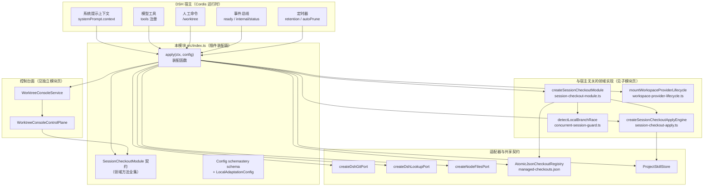
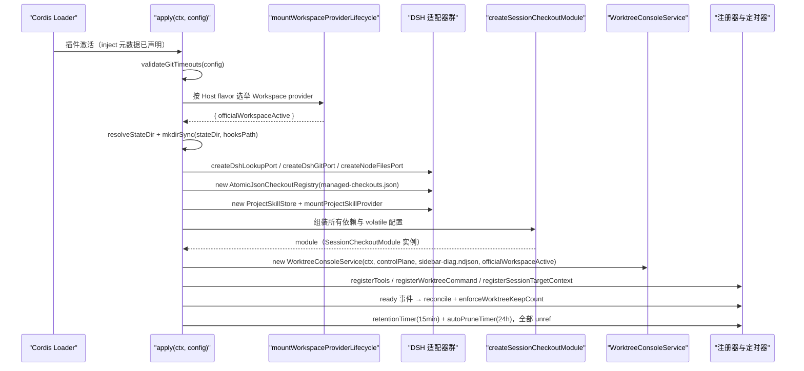
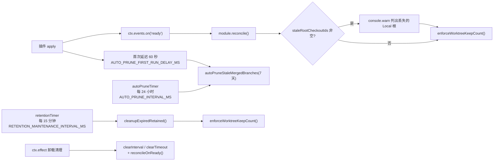

# 工作树生命周期管理核心入口（src/index.ts）

本页是 `dsh-git-worktree` 插件的**宿主装配入口**文档：它定义了领域模块对外的稳定契约（`SessionCheckoutModule` 接口、`SessionCheckoutError` 错误类型、各输入/交接类型），并在 DSH（DeepSeek Harness）宿主中完成全部适配器、状态机、工具、命令、系统提示上下文与控制台服务的挂载。session-checkout 领域本身（状态机、apply 引擎、端口）是**与宿主无关**的，本文件是它与 Cordis 插件世界之间的唯一接缝。

> 模块在仓库中的源码位置：`src/index.ts`；构建产物经 `package.json` 的 `main: lib/index.js` 对外发布。

## 目录

- [在整体架构中的位置](#在整体架构中的位置)
- [核心契约：SessionCheckoutModule](#核心契约sessioncheckoutmodule)
- [错误模型：SessionCheckoutError 与 reconcile 汇总](#错误模型sessioncheckouterror-与-reconcile-汇总)
- [输入与交接类型一览](#输入与交接类型一览)
- [插件装配流程（apply）](#插件装配流程apply)
- [配置面：Config 与 LocalAdaptationConfig](#配置面config-与-localadaptationconfig)
- [生命周期定时器与启动恢复](#生命周期定时器与启动恢复)
- [与其他模块的关系](#与其他模块的关系)

## 在整体架构中的位置



**要点：**

- `apply(ctx, config)` 是 Cordis 插件 loader 调用的挂载函数；`export const inject = { tools: {}, commands: {}, subprocess: {}, loader: { await: false } }` 声明了它的注入元数据——loader 注入列表为空，注释明确指出：裸函数导出会以"无注入列表"方式挂载，第一次访问 `ctx.tools` 就会因未注入而失败。
- 状态目录解析为 `<DSH_HOME>/plugins/dsh-git-worktree`（`DSH_HOME` 未设置时回退 `~/.dsh`），并在其中创建 `disabled-git-hooks/` 与 `managed-checkouts.json`。
- `registerTools`、`registerWorktreeCommand`、`registerSessionTargetContext` 三个注册器把同一 `SessionCheckoutModule` 暴露给三条不同的交互面（模型、人、系统提示）。

## 核心契约：SessionCheckoutModule

`SessionCheckoutModule` 是领域模块对所有业务调用方（工具层、命令层、控制台控制面、启动恢复）暴露的**完整接口**。按职责分组如下：

| 分组 | 方法 | 职责 |
| --- | --- | --- |
| 只读观察 | `inspect`、`runtimeContext`、`observeManagedCheckout`、`observeManagedCheckouts`、`listManagedWorktrees`、`listManagedWorktreesForSession`、`inspectManagedWorktreeCleanup` | 读取 `SessionTargetView`、生成回放稳定的同步模型上下文、批量快照托管 checkout |
| 预检（只读） | `preflight`、`preflightPreviewRecovery` | 应用前事实采集；`preflightPreviewRecovery` 针对 detached Preview 恢复场景做严格只读评估 |
| 排他锁原语 | `runExclusiveSessionMutation<T>` | 与 bind/apply/discard/cleanup 同一把排他锁下执行跨模块变更 |
| 绑定与隔离 | `bind`、`createIsolatedTarget`、`beginNextIteration`、`resumeRevision` | 把会话绑定到 Local 或隔离 checkout；为交付后的工作树开启下一轮迭代 |
| 恢复交接 | `prepareReviewRegeneration`、`preparePreviewRecoveryAnalysis`、`createPreviewRecoveryHandoff` | 持久化宿主权威的一次性只读请求与 Preview 恢复 proof |
| 交付流转 | `markReadyForReview`、`operate`、`isAutoDeliverEnabled` | 标记待评审、执行 apply 状态机操作、查询自动交付开关 |
| 分支与清理 | `pruneMergedBranchesForSession`、`autoPruneStaleMergedBranches`、`mergeBranchForSession`、`cleanupExpiredRetained`、`enforceWorktreeKeepCount`、`bulkCleanupManagedWorktrees`、`manageManagedWorktree`、`manageManagedWorktreeForSession` | 分支 prune（安全 `-d` 语义、永不 force）、LRU 逐出、保留期到期清理、按调用方鉴权的管理操作 |
| 放弃快照 | `listAbandonedWorktreeSnapshots`、`restoreAbandonedWorktreeSnapshot` | codex 对齐的放弃工作树列表与恢复为 Local 分支 |
| 路径解析 | `resolveManagedRoot`、`resolveRoots` | 身份校验后返回托管根 / 双侧根目录 |
| 并发守卫 | `refreshBranchRaceGuards?`（可选） | 后台刷新所有已知 Local 根的分支创建时间缓存 |
| 启动恢复 | `reconcile` | 对账孤儿、脏孤儿、陈旧根与需恢复的 checkout |

**关键设计约束（注释原文要点）：**

- `runtimeContext(sessionId, cwd?)` 是**同步**注册表快照——系统提示契约要求它保持同步，因此 `refreshBranchRaceGuards` 必须火忘式（fire-and-forget），失败时保留上一份快照。
- `createIsolatedTarget` 预留一个独立的 owner 会话与 checkout，**不改变**源会话的 cwd/身份；返回的 `IsolatedTargetLaunch` 是客户端创建权威隔离 Workspace/Session 的交接数据。
- `manageManagedWorktreeForSession` 只做调用方鉴权，**绝不**把持久化的 owner id 当作授权依据。

状态机与 apply 引擎的内部实现细节（receipt-first Local Preview、rollback/finalize、crash recovery、fingerprint CAS）见 [session_checkout](session_checkout.md)；并发守卫的纯谓词实现见 [concurrency](concurrency.md)。

## 错误模型：SessionCheckoutError 与 reconcile 汇总

### SessionCheckoutError

```ts
export class SessionCheckoutError extends Error {
  readonly code: SessionCheckoutErrorCode
  constructor(code: SessionCheckoutErrorCode, message: string)
}
```

- 由 session-checkout 状态机及其适配器抛出的**稳定领域失败**；`code` 来自 `SESSION_CHECKOUT_ERROR_CODES`（定义于 [shared_contracts_and_domain_ports](../shared_contracts_and_domain_ports.md) 的 `src/types.ts`）。
- `message` 是面向用户的文案，工具层逐字（verbatim）上抛给模型。已知码包括 `session_not_found`、`project_not_found`、`project_root_missing` 等。
- 另有专门的 `WorktreeCreationFailure`（携带 `rolledBack` 标志，表示创建失败不等于"空路径就是安全的"），见 [creation_failure](creation_failure.md)。

### SessionCheckoutReconcileSummary

```ts
export interface SessionCheckoutReconcileSummary {
  recoveryRequiredCheckoutIds: string[]
  orphanedCheckoutIds: string[]
  dirtyOrphanedCheckoutIds: string[]
  staleRootCheckoutIds: string[]
  retainedCheckoutCount: number
}
```

启动对账把注册表与磁盘真实状态比对后归为四类：需要恢复、孤儿（目录已消失）、脏孤儿（目录仍在且有改动）、陈旧根（Local 仓库可能已移动）。`apply` 在 `ready` 事件中调用 `reconcile()`，当 `staleRootCheckoutIds` 非空时输出 warn 日志，并紧接着执行 `enforceWorktreeKeepCount()`。

## 输入与交接类型一览

| 类型 | 字段要点 | 用途 |
| --- | --- | --- |
| `IsolatedTargetLaunch` | `targetSessionId`、`managedRoot`、`target: SessionTargetView` | 客户端据此创建权威隔离 Workspace/Session |
| `MarkReadyForReviewInput` | `summary`、`tests`、`validationStatus`、`suggestedCommitMessage`、`detailsMarkdown?`、`validationSummary?` | 评审就绪时提交验收证据 |
| `ManageManagedWorktreeInput` | `checkoutId`、`expectedRevision`、`action`（cleanup_retained / retry_cleanup / set_retention / set_permanent / clear_sidebar_badge / discard）、`retention?`、`permanent?`、`confirmDirty?`、`rollbackPreview?` | 按调用方鉴权的单条托管 checkout 管理操作 |
| `ListManagedWorktreesInput` | `projectId?`、`needsAttention?`、`checkoutId?`、`includeDiagnostics?` | 列表过滤维度 |
| `PruneMergedBranchesInput` | `dryRun?`、`olderThanDays?` | dryRun 只报告不删 ref；年龄过滤可选 |
| `MergeBranchForSessionInput` | `sourceBranch`、`dryRun?`、`direction?: 'forward' \| 'reverse'` | forward=工作树分支合入 Local；reverse=把 Local HEAD 同步进工作树分支，冲突留在工作树 |
| `LocalAdaptationConfig` | `autoDeliver`、`autoPush`、`worktreesRoot`、`inheritLocalChanges`、`worktreeKeepCount`、`branchRaceGuard`、`branchRaceWindowMs`、`enableWorkspaceProvider` | 每个字段既接受静态值也接受 `LiveValue`（volatile 实时引用） |

> `SessionTargetView`、`SessionCheckoutOperation`、`WorktreeRetentionMode`、`WorktreePreviewRecoveryProof` 等视图/操作类型定义在共享契约层，参见 [shared_contracts_and_domain_ports](../shared_contracts_and_domain_ports.md)。

## 插件装配流程（apply）



**装配顺序的三个约束性细节：**

1. **Workspace provider 选举先于一切**：`mountWorkspaceProviderLifecycle(ctx, hostWorkspaceClientFlavor(), { enabled: config.enableWorkspaceProvider === true })` 在 legacy 0.1.x 宿主上必须显式 `true` 才接管；在现代 0.2.x 宿主上接管是强制的（装饰注册拿不到官方 Browser 的 child-slot 席位会崩）。其完整的 Loader disable/restore 选举算法见 [workspace_provider_lifecycle](workspace_provider_lifecycle.md)，Host 版本探测见 [host_compat](host_compat.md)。
2. **volatile 配置包成 LiveValue**：`worktreesRoot` 被包成 `{ get: () => resolveWorktreesRootValue(...) }`，设置页编辑无需重挂载即生效；其余 volatile 字段（`gitTimeoutMs`、`autoDeliver`、`autoPush` 等）由 schema 的 `meta.volatile` 标记，设置宿主读取该标记后把值以实时引用形式注入。
3. **控制台服务消费 `officialWorkspaceActive`**：`WorktreeConsoleService` 把该结果写入侧边栏拓扑响应，决定前端走"接管"还是"装饰共存"路径。

## 配置面：Config 与 LocalAdaptationConfig

Config 由 schemastery（`@deepseek-ai/schemastery`，见 `package.json` 依赖）定义，`volatile()` 辅助函数给每个可热编辑字段打上 `meta.volatile = true`：

| 配置项 | 默认值 | 说明 |
| --- | --- | --- |
| `stateDir` | `$DSH_HOME/plugins/dsh-git-worktree` | 插件状态目录（注册表、disabled-hooks 根） |
| `gitTimeoutMs` | `DEFAULT_GIT_TIMEOUT_MS`（上限 `MAX_GIT_TIMEOUT_MS`） | Git 命令超时 |
| `worktreeAddTimeoutMs` | 300_000 | `git worktree add` 专用超时 |
| `autoDeliver` | `true` | Agent 自主交付开关；关闭时工具层拒绝模型驱动交付 |
| `autoPush` | `true` | Finish 成功后 best-effort `git push`（永不 force，失败只报告） |
| `worktreesRoot` | 未设置 | 设置后 worktree 创建于 `<worktreesRoot>/<project>/<topic>-<YYYYMMDD>` |
| `inheritLocalChanges` | `true` | 创建受管 worktree 时继承本地未提交修改（tracked 打补丁、未 ignore 的 untracked 复制），仅基点 == 本地 HEAD 时生效，失败只告警 |
| `worktreeKeepCount` | `15`（0 关闭，上限 500） | 托管总量 LRU 上限，permanent 常驻与进行中会话豁免 |
| `branchRaceGuard` | `true` | 并发分支竞争守卫总开关 |
| `branchRaceWindowMs` | 30 分钟（60s–24h） | 竞争检测窗口 |
| `enableWorkspaceProvider` | `false` | 仅显式 `true` 才接管官方 Workspace UI（客户端包会从 Host 图中移除，风险高） |

> 构建与发布相关的脚本（`build`、`check:publish`、`check:sidebar-version`、`dev:dsh:*`、`prepublishOnly`）与 `engines.node`、`peerDependencies` 宿主版本矩阵见 [build_and_configuration](../build_and_configuration.md)。

## 生命周期定时器与启动恢复



- 所有定时器都调用 `.unref?.()`，不阻止事件循环退出；`ctx.effect` 的清理函数在纤维卸载时同时停止定时器。
- 自动 prune 的年龄阈值硬编码为 7 天（`AUTO_PRUNE_OLDER_THAN_DAYS`），首次运行在启动后 60 秒触发，让频繁重启的宿主也能保持每日清扫。

## 与其他模块的关系

- **状态机与 apply 引擎**（本页契约的实现）：[session_checkout](session_checkout.md)
- **并发分支守卫**（`detectLocalBranchRace` 纯谓词）：[concurrency](concurrency.md)
- **Worktree 创建失败类型**：[creation_failure](creation_failure.md)
- **Host 版本风味探测**：[host_compat](host_compat.md)
- **受管 worktree 路径/分支名候选生成**：[managed_worktree_path](managed_worktree_path.md)
- **系统提示上下文注册器**（`registerSessionTargetContext` + `ContextAgent`）：[session_target_context](session_target_context.md)
- **Workspace provider 选举生命周期**：[workspace_provider_lifecycle](workspace_provider_lifecycle.md)
- **共享契约与端口**（`ports.ts`、`types.ts`、`console-contract.ts`、git/lookup/registry 适配器）：[shared_contracts_and_domain_ports](../shared_contracts_and_domain_ports.md)
- **控制台控制面与服务**（`WorktreeConsoleControlPlane`、`WorktreeConsoleService`、review-diff reader；本页 `apply` 组装它们）：[console_control_plane_and_services](../console_control_plane_and_services.md)
- **客户端消费面**（侧边栏拓扑、目标控制台通过 typert remote 调用本契约）：[client](../client.md)
- **构建、CI 与配置产物**（`package.json`、`cordis.patch.yml`、`tsconfig.json`、`vitest.config.ts`）：[build_and_configuration](../build_and_configuration.md)
