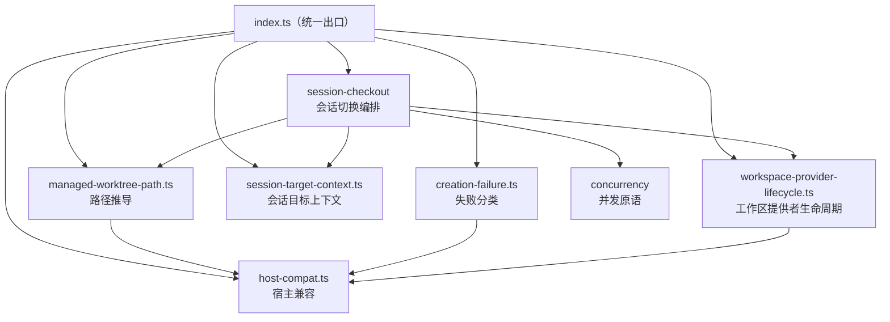
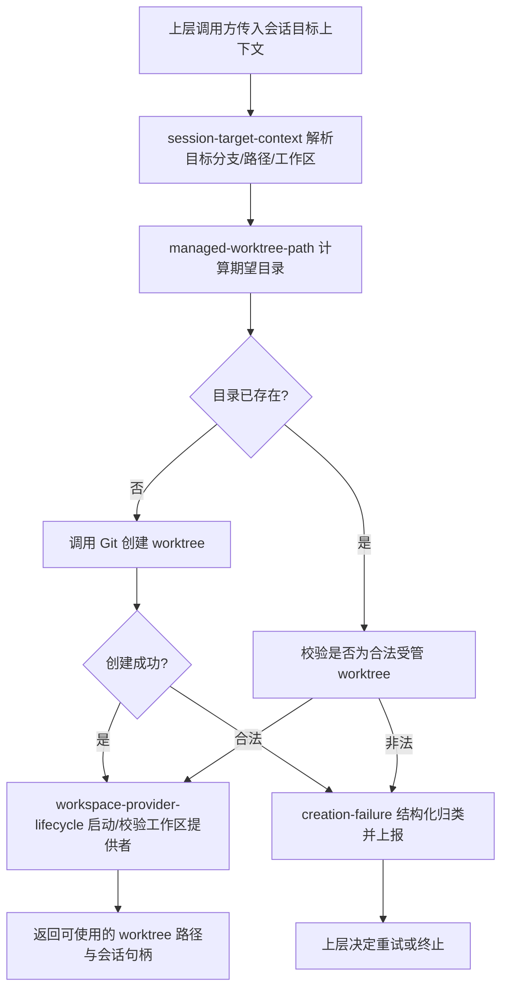

# worktree_lifecycle_management_core 概览

`worktree_lifecycle_management_core` 是本项目的 **Git worktree 生命周期管理核心域模块**。它并不直接暴露给用户使用，而是封装了 worktree 的路径推导、创建、失败处理、宿主环境兼容、会话切换（checkout）以及工作区提供者（workspace provider）的生命周期编排，供上层控制台、远程会话与客户端组合调用。

## 模块目标

该模块承担以下职责：

- 以 `managed-worktree-path.ts` 统一推导受管 worktree 的目录结构，避免硬编码路径散落各处。
- 在 `session-checkout` 中根据当前会话上下文决定是否需要新建、复用或切换 worktree，保障多会话并发下的隔离性。
- 通过 `creation-failure.ts` 对创建失败进行结构化分类与上报，便于上层重试或提示。
- 借助 `host-compat.ts` 屏蔽 Windows、macOS、Linux 等宿主环境差异（如路径分隔符、权限、符号链接等）。
- 通过 `session-target-context.ts` 表达「当前会话希望切换到哪个分支/路径/工作区」的上下文对象，作为 checkout 决策的输入。
- 通过 `workspace-provider-lifecycle.ts` 管理外部工作区提供者（如远程 dev container、容器运行时等）的初始化、健康检查与销毁。
- `index.ts` 对外统一再导出上述能力，方便外部模块以单一入口导入。

## 架构图

### 模块组成与依赖关系

### 一次会话切换（checkout）的典型流程

## 核心组件文档

各子模块的详细说明请参见以下文档：

- [统一出口 index.ts](worktree_lifecycle_management_core/worktree_lifecycle_management_core_index.md)
- [会话切换编排 session-checkout](worktree_lifecycle_management_core/session_checkout.md)
- [创建失败处理 creation-failure.ts](worktree_lifecycle_management_core/creation_failure.md)
- [宿主兼容层 host-compat.ts](worktree_lifecycle_management_core/host_compat.md)
- [受管 worktree 路径推导 managed-worktree-path.ts](worktree_lifecycle_management_core/managed_worktree_path.md)
- [会话目标上下文 session-target-context.ts](worktree_lifecycle_management_core/session_target_context.md)
- [工作区提供者生命周期 workspace-provider-lifecycle.ts](worktree_lifecycle_management_core/workspace_provider_lifecycle.md)

> 备注：`concurrency` 子模块目前尚未生成独立文档，它主要为 `session-checkout` 提供会话级并发原语（如互斥锁、去重），后续将补充。